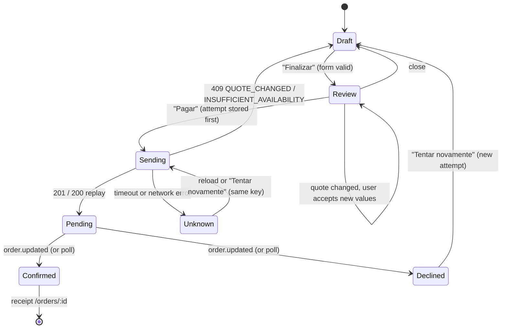

# KURIO — Architecture

**English** · [Português (Brasil)](ARCHITECTURE.pt-BR.md)

How the NFT marketplace frontend is built and why. The challenge brief is [`OBJETIVES.md`](OBJETIVES.md); how to run and evaluate the app is the [README](README.md). Every decision below was taken in a spec of [`SPECS-NTFS/`](SPECS-NTFS/README.md) (requirements, design and tasks per area), which stays in the repository as the design record. Links in this document point there for the full reasoning.

UI copy is pt-BR, as in Figma; documents, code and comments are English.

## Contents

1. [Overview](#1-overview)
2. [Source layout and import boundaries](#2-source-layout-and-import-boundaries)
3. [REST contracts](#3-rest-contracts)
4. [Realtime](#4-realtime)
5. [Session](#5-session)
6. [Cart](#6-cart)
7. [Checkout and orders](#7-checkout-and-orders)
8. [Cache, retry and sync policy](#8-cache-retry-and-sync-policy)
9. [Mock environment](#9-mock-environment)
10. [Testing strategy](#10-testing-strategy)
11. [Accessibility adjustments](#11-accessibility-adjustments)
12. [Performance notes](#12-performance-notes)
13. [Deviations and decisions](#13-deviations-and-decisions)
14. [Limitations](#14-limitations)

## 1. Overview

A client-only SPA: React 19 and TypeScript, TanStack Router (file-based routes, code-split) and TanStack Query, Axios, Zod 4, Tailwind v4 with shadcn/ui, Playwright and Lighthouse. There is no backend. The REST API and the Socket.IO server are **simulated inside the page**: MSW intercepts `fetch` and WebSocket traffic in a Service Worker and a mock database in `localStorage` answers it. The app code does not know: it talks to `VITE_API_BASE_URL` and `VITE_REALTIME_URL` as it would to a real server, and a build with `VITE_ENABLE_MOCKS=false` contains no mock code at all.

```mermaid
flowchart LR
  UI["Screens and hooks<br/>(features/*, routes/*)"] --> Q["TanStack Query<br/>cache, retry, dedupe"]
  Q --> API["api/* endpoint functions<br/>(Zod-parsed responses)"]
  API --> AX["Axios instance<br/>lib/http: bearer, 401, errors"]
  AX -- "fetch" --> SW["MSW Service Worker<br/>(in the browser)"]
  SW --> H["mocks/handlers<br/>latency, failure rules"]
  H --> DB[("Mock database<br/>localStorage")]
  DB --> BUS["Domain bus"]
  BUS --> HUB["Realtime hub<br/>audience, delivery log"]
  HUB -- "WebSocket frames" --> BIND["Socket.IO binding<br/>(@mswjs/socket.io-binding)"]
  BIND --> RT["lib/realtime manager<br/>schema, dedupe, version guard"]
  RT -- "patch or invalidate" --> Q
  RT -- "listeners" --> UI
```



Two rules shape everything else. The **contracts** (`src/contracts/`, Zod) are the only description of the wire: the client parses every response with them and the mock handlers validate every request with them, so they cannot disagree. And **server state belongs to Query**: components never hold a copy of API data, mutations go through Query, and realtime events end in the same cache.

Boot ([spec 13 §5](SPECS-NTFS/13-lighthouse/design.md), [spec 02 §3](SPECS-NTFS/02-contracts-mocks/design.md)): `main.tsx` renders the shell at once and starts the mock chunk in parallel. Every Axios request and the Socket.IO connection wait on `lib/backend-ready.ts` until the worker is proven to intercept, so nothing reaches the network by accident. `bootApp()` wires the session to the cache, the router and the socket.

## 2. Source layout and import boundaries

```
src/
  app/          bootstrap: router, query client, session bridge, boot wiring, devtools (dev only)
  routes/       file-based routes: guards, loaders, search validation, page <title>; thin
  features/     one folder per area, each with api/ (query options, mutations), model/ (pure logic,
                stores), components/: auth, account, cart, catalog, checkout, explorer, favorites,
                nft-details, orders, receipt; ui-kit and dev-realtime are developer harnesses
  components/   shared UI: ui/ (shadcn restyled), form/ (form layer), layout/ (shells), icons/
  api/          endpoint functions, one per operation, built on the Axios instance
  contracts/    Zod schemas, error taxonomy, operation table, event envelope
  lib/          http/ (Axios, errors, auth interceptors), realtime/, money, env, backend-ready, mock-recovery
  mocks/        MSW handlers, mock database, fixtures, scenarios, control API, panel, realtime hub
  styles/       Tailwind theme tokens from Figma
```

Boundaries are enforced by ESLint (`no-restricted-imports`, [spec 00 §9](SPECS-NTFS/00-foundation/design.md), [spec 02 §12](SPECS-NTFS/02-contracts-mocks/design.md), [spec 03 §7](SPECS-NTFS/03-realtime/design.md)), so they fail `pnpm lint` rather than a review:

| Rule | Why |
|---|---|
| `axios` only inside `lib/http/`; `fetch` nowhere in `src/` | One instance carries the base URL, timeout, bearer, error mapping and cancellation |
| `socket.io-client` only inside `lib/realtime/` | One manager owns connection, dedupe and reconciliation |
| `@mswjs/socket.io-binding` and everything under `mocks/` only from `mocks/` and the bootstrap's dynamic import (`main.tsx`) | Mock code must be removable from a build |
| `contracts/` imports only `zod` and `lib/money` | Contracts are shared by client and server code; no React, no MSW |
| `mocks/` never imports `api/`, `lib/http`, `lib/realtime`, `features/`, `routes/` | Mocks implement the server; they must not use the client |
| No icon package (`lucide-react` blocked) | Icons come from the Figma exports in `src/assets/` |

Routes are thin on purpose: a route file declares its path, `validateSearch` (Zod 4 schemas with `.catch()`/optional fields, so a malformed URL degrades to defaults instead of throwing), a guard (`requireAuth`), a loader that starts the Query fetch, and the page component from `features/`. There is no `_authenticated` layout; each private route calls `requireAuth` ([spec 04 §6](SPECS-NTFS/04-auth-session/design.md)).

## 3. REST contracts

The operation table lives in `src/contracts/operations.ts` and is shared by the client (`api/`) and the mock server (`mocks/handlers`). The table below is generated from it by `pnpm docs:update` (and checked by `pnpm test`), so it cannot drift; the request, success and error columns come from a map typed over every operation id, so adding an operation fails the type check until it is described. Base URL: `VITE_API_BASE_URL` (default `/api`).

<!-- generated:operations -->

| Operation | Method and path | Auth | Request | Success | Errors |
|---|---|---|---|---|---|
| `auth.signup` | `POST /auth/signup` | none | `SignupBody` | 201 `SessionPayload` | 422, 409 `EMAIL_TAKEN` / `USERNAME_TAKEN` |
| `auth.login` | `POST /auth/login` | none | `LoginBody` | 200 `SessionPayload` | 422, 401 `INVALID_CREDENTIALS` |
| `auth.session` | `GET /auth/session` | bearer | — | 200 `SessionInfo` | 401 |
| `auth.logout` | `POST /auth/logout` | bearer, ignored if invalid | — | 204 | — |
| `nfts.list` | `GET /nfts` | optional bearer | `NftListQuery` | 200 `NftListResponse` | 422, 401 (with `favorites`) |
| `nfts.get` | `GET /nfts/:nftId` | none | — | 200 `NftDetail` | 404 |
| `nfts.related` | `GET /nfts/:nftId/related` | none | — | 200 `{ items: NftSummary[] }` | 404 |
| `highlights.get` | `GET /highlights` | none | — | 200 `Highlights` | — |
| `networks.list` | `GET /networks` | none | — | 200 `{ items: PaymentNetwork[] }` | — |
| `explorer.getTransaction` | `GET /explorer/:network/tx/:txHash` | none | — | 200 `ExplorerTransaction` | 404 |
| `favorites.list` | `GET /favorites` | bearer | — | 200 `{ nftIds: NftId[] }` | 401 |
| `favorites.add` | `PUT /favorites/:nftId` | bearer | — | 204 | 401, 404 |
| `favorites.remove` | `DELETE /favorites/:nftId` | bearer | — | 204 | 401 |
| `cart.get` | `GET /cart` | bearer or guest cart id | — | 200 `Cart` | 401 |
| `cart.addItem` | `POST /cart/items` | bearer or guest cart id | `AddCartItemBody` | 200 `Cart` | 422, 404, 409 `INSUFFICIENT_AVAILABILITY` / `EDITION_UNAVAILABLE` |
| `cart.updateItem` | `PATCH /cart/items/:itemId` | bearer or guest cart id | `UpdateCartItemBody` | 200 `Cart` | 422, 403, 404, 409 |
| `cart.removeItem` | `DELETE /cart/items/:itemId` | bearer or guest cart id | — | 200 `Cart` | 403, 404 |
| `cart.applyCoupon` | `PUT /cart/coupon` | bearer or guest cart id | `{ code }` | 200 `Cart` | 422 `COUPON_INVALID` / `COUPON_EXPIRED` / `COUPON_NOT_APPLICABLE` |
| `cart.removeCoupon` | `DELETE /cart/coupon` | bearer or guest cart id | — | 200 `Cart` | — |
| `cart.merge` | `POST /cart/merge` | bearer | `{ guestCartId }` | 200 `CartMergeResult` | 401, 422 |
| `quote.get` | `GET /cart/quote` | bearer or guest cart id | query `network` | 200 `Quote` | 422 |
| `orders.create` | `POST /orders` | bearer | `CreateOrderBody` + `Idempotency-Key` | 201 `Order` (200 on replay) | 401, 422, 409 `QUOTE_CHANGED` / `INSUFFICIENT_AVAILABILITY` / `IDEMPOTENCY_CONFLICT` / `ORDER_PENDING` / `WALLET_NOT_CONNECTED` |
| `orders.get` | `GET /orders/:orderId` | bearer | — | 200 `Order` | 401, 403, 404 |
| `orders.list` | `GET /orders` | bearer | query `status` | 200 `{ items: OrderSummary[] }` | 401 |
| `profile.get` | `GET /profile` | bearer | — | 200 `Profile` | 401 |
| `profile.update` | `PUT /profile` | bearer | `UpdateProfileBody` | 200 `Profile` | 401, 422, 409 `USERNAME_TAKEN` / `EMAIL_TAKEN` |
| `profile.uploadAvatar` | `PUT /profile/avatar` | bearer | multipart `file` | 200 `Profile` | 401, 413, 415 |
| `profile.removeAvatar` | `DELETE /profile/avatar` | bearer | — | 200 `Profile` | 401 |
| `profile.changePassword` | `PUT /profile/password` | bearer | `ChangePasswordBody` | 204 | 401, 422 |
| `wallets.list` | `GET /wallets` | bearer | — | 200 `{ items: Wallet[] }` | 401 |
| `wallets.create` | `POST /wallets` | bearer | `CreateWalletBody` | 201 `Wallet` | 401, 422, 409 `WALLET_DUPLICATE` / `WALLET_ROLE_TAKEN` |
| `wallets.update` | `PUT /wallets/:walletId` | bearer | `WalletFields` | 200 `Wallet` | 401, 403, 404, 422, 409 `WALLET_DUPLICATE` |
| `walletConnections.list` | `GET /wallet-connections` | bearer | — | 200 `{ items: WalletConnection[] }` | 401 |
| `walletConnections.connect` | `POST /wallet-connections` | bearer | `{ walletId, provider, network }` | 201 `WalletConnection` | 401, 403, 404, 422, 409 `WALLET_REJECTED` |
| `walletConnections.disconnect` | `DELETE /wallet-connections/:connectionId` | bearer | — | 204 | 401, 403, 404 |

<!-- /generated:operations -->

Headers: `Authorization: Bearer <token>`; `X-Guest-Cart-Id: <id>` (ignored when a valid bearer is present); `Idempotency-Key: <8–64 chars>` on `orders.create`. Any operation can additionally answer 429, 500 or 503. Resource schemas are in `src/contracts/*.ts`; the summary is in [spec 02 §4](SPECS-NTFS/02-contracts-mocks/design.md).

**Error envelope.** Every error body is `{ error: { code, message, fields?, details? } }`. `code` is a closed union, `message` is pt-BR and safe to show, `fields` maps dotted field paths to messages (`collector.email`), and `details` has a shape per code (`QUOTE_CHANGED` carries the new quote, `INSUFFICIENT_AVAILABILITY` the lines and their limits, `RATE_LIMITED` a `retryAfterMs`). The client turns a failed request into one `ApiError` with a `kind` (`network`, `timeout`, `http`, `cancelled`, `contract`, `unknown`) and parses the envelope; a body that does not match its code's `details` schema becomes `UNKNOWN`, so the client never narrows on a broken contract. `isApiError(e, 'QUOTE_CHANGED')` narrows `e.details`.

<!-- generated:errors -->

| Code | Status | Default message (pt-BR) |
|---|---|---|
| `VALIDATION_FAILED` | 422 | Alguns campos precisam de atenção. |
| `COUPON_INVALID` | 422 | Cupom inválido. |
| `COUPON_EXPIRED` | 422 | Este cupom expirou. |
| `COUPON_NOT_APPLICABLE` | 422 | Este cupom não se aplica ao seu carrinho. |
| `UNAUTHENTICATED` | 401 | Entre na sua conta para continuar. |
| `SESSION_EXPIRED` | 401 | Sua sessão expirou. Entre novamente. |
| `INVALID_CREDENTIALS` | 401 | E-mail ou senha incorretos. |
| `FORBIDDEN` | 403 | Você não tem permissão para acessar este recurso. |
| `NOT_FOUND` | 404 | Recurso não encontrado. |
| `INSUFFICIENT_AVAILABILITY` | 409 | A quantidade pedida não está mais disponível. |
| `EDITION_UNAVAILABLE` | 409 | Esta edição está esgotada. |
| `QUOTE_CHANGED` | 409 | Os valores do seu pedido mudaram. Revise e confirme novamente. |
| `IDEMPOTENCY_CONFLICT` | 409 | Esta tentativa já foi usada com outro conteúdo. |
| `ORDER_PENDING` | 409 | Você já tem um pedido aguardando confirmação. |
| `EMAIL_TAKEN` | 409 | Este e-mail já está cadastrado. |
| `USERNAME_TAKEN` | 409 | Este nome de usuário já está em uso. |
| `WALLET_DUPLICATE` | 409 | Este endereço já está em outra carteira sua. |
| `WALLET_ROLE_TAKEN` | 409 | Você já tem uma carteira neste papel. |
| `WALLET_REJECTED` | 409 | A carteira recusou a conexão. |
| `WALLET_NOT_CONNECTED` | 409 | Conecte a carteira para continuar. |
| `PAYLOAD_TOO_LARGE` | 413 | O arquivo é grande demais. |
| `UNSUPPORTED_MEDIA_TYPE` | 415 | Formato de arquivo não suportado. |
| `RATE_LIMITED` | 429 | Muitas tentativas. Aguarde um momento. |
| `INTERNAL` | 500 | Algo deu errado do nosso lado. Tente novamente. |
| `SERVICE_UNAVAILABLE` | 503 | Serviço temporariamente indisponível. |

<!-- /generated:errors -->

**Money.** ETH amounts are decimal strings (`'12.30'`), never JSON numbers, and every calculation goes through `lib/money.ts` (big.js): no floating-point arithmetic touches a price. The mock normalizes prices to strings with a fixed scale, so string equality never decides a price change (it uses `eth.cmp`). All amounts are in ETH, including on Solana: the payment network changes only the fee and the wallet family ([spec 02 decision 3](SPECS-NTFS/02-contracts-mocks/design.md)).

**Idempotency.** `orders.create` requires an `Idempotency-Key`. The server stores `key → (body fingerprint, order)`: the same key with the same body returns the same order (200 instead of 201), the same key with another body is `IDEMPOTENCY_CONFLICT`, and a user with an order still pending gets `ORDER_PENDING` with its id. The client side of the contract is [§7](#7-checkout-and-orders).

**Quotes have no stored id or expiry.** A quote id is a content fingerprint (subtotal, lines, coupon, fee, availability), so revalidation is recomputing and comparing: any change in price, stock, coupon or network fee changes the id and answers `QUOTE_CHANGED` ([spec 02 §8.3](SPECS-NTFS/02-contracts-mocks/design.md)).

**Ownership.** Another user's id-addressed resource (an order, a wallet, a cart line) answers 403, not 404, so the brief's "insufficient permissions" case is observable.

## 4. Realtime

Two events, both over Socket.IO with the WebSocket transport only: `nft.updated` (a price or an edition's availability changed) and `order.updated` (an order moved to `confirmed` or `declined`). The event name equals `type` and the payload is the whole envelope:

```ts
{ id: 'evt_nft.updated_emerald-ape-042_4',   // evt_<type>_<resourceId>_<version>
  type: 'nft.updated' | 'order.updated',
  resource: { type: 'nft' | 'order', id },
  version: number,                            // the resource's version after the change
  occurredAt: IsoDateTime,
  data: NftLive | OrderLive }                 // live fields, never a delta
```

Because `data` holds the resource's **current live fields**, applying only the newest event gives the right state: a skipped version is harmless, and a redelivery has the same id.

**Client pipeline** (`lib/realtime/manager.ts`, [spec 03 §6](SPECS-NTFS/03-realtime/design.md)). For each incoming event: drop it if it came from a stale socket; parse it with the schema (an invalid payload is dropped with a warning); run the **guard**, which classifies it as `duplicate` (id already seen), `stale` (version not newer than the last applied for that resource, or than the cached data) or `known` (the cache already has that version, but older entries may still need healing); apply it to the cache; call listeners. The default appliers patch `['nfts', …]` and `['orders', 'detail', id]` in place with `setQueryData(…, { updatedAt })`, keeping each entry's own `dataUpdatedAt` so patching never makes stale data look fresh, and never revert anything newer. Lists are marked stale without an immediate refetch, so a list sorted by price does not flicker.

**Subscriptions and session isolation.** The manager connects only when it has been started **and** the session is known, so a signed-in user never connects first as a guest; the socket sends `auth: { token }` (`{}` for a guest). `nft.updated` goes to every connection, `order.updated` only to the owner's connections whose session is still valid at delivery time. Any identity change replaces the socket (`off`, `disconnect`, a new instance with the new token) and resets the guard, and every handler first checks that its socket is still the current one. The server-side audience check and the client-side guard are two independent layers.

**Reconnection and reconciliation.** Status is `connecting`, `connected`, `reconnecting` or `disconnected`. On a `connect` that follows an earlier connect of the same socket, the manager invalidates every cached query: the active ones refetch (prices, stock, orders settled while the socket was down) and the rest are stale on next use. There is no server-side log of missed events, so **REST reconciliation is the recovery mechanism**; a real backend would add a resume cursor, which the brief does not ask for. A pending order also has a 5 s REST poll as a fallback that stops at a terminal status.

**What listens beyond the screens** (`app/boot.ts`): an always-on `nft.updated` listener (also for `known` events) refreshes the cart if the owner's cart holds a line of that NFT, wherever the user is; an `order.updated` listener records events that arrive before the cached order exists (R7), and a terminal status invalidates the cart and the order lists and ends the stored checkout attempt of a confirmed order.

**Transport used by the mock and its limits** ([spec 03 §3, §12](SPECS-NTFS/03-realtime/design.md)). Be explicit about what is simulated:

- The Socket.IO "server" runs **inside the page's Service Worker interception**, not in a separate process: MSW's WebSocket support plus `@mswjs/socket.io-binding@0.2.0`. It is WebSocket only, with no long-polling fallback.
- The binding has no rooms, namespaces, acknowledgements or heartbeat, so the mock hub routes by connection itself and pings every 20 s. It hides the CONNECT `auth`, so the mock parses the raw `40{…}` frame. MSW strips the `/socket.io/` path. Refusing a connection (`offline`, drop with `block`) uses a private MSW object (`Reflect.get(client, 'socket')`); if MSW changes it, refusal degrades to the 10 s connect timeout.
- Events reach **only the tab that caused the change**: the mock database lives in `localStorage` and publishes domain changes in the tab that wrote them; other tabs catch up on focus (multi-tab: last write wins).
- A real network drop below the WebSocket cannot be simulated; disconnection is driven by the mock control (`__mock.realtime.drop()`, the `offline` scenario, "Tempo real indisponível" in the panel).
- A change committed between the first REST read and the socket handshake is not pushed. Reconnections reconcile; the first connection does not (R6 was tried twice and removed: it cost one extra request on every cold load and made request-counting tests intermittent, [spec 03 §14](SPECS-NTFS/03-realtime/design.md)). The 5 s order poll, window-focus refetch and the checkout's quote revalidation cover the data that matters.
- With mocks off, `VITE_REALTIME_URL` must point to a real server; the default is a reserved `.example` host so a failed interception can never reach one.

## 5. Session

Implemented in `features/auth/model/session.ts` as a controller created by a factory (storage, verify, clock injected) with a singleton in `instance.ts` ([spec 04](SPECS-NTFS/04-auth-session/design.md)).

- **Token storage.** Bearer token and user summary in `localStorage` (`kurio.session`). This is a simulation choice: in production the token would be an HttpOnly, SameSite cookie, which a SPA cannot read, so the cart and checkout would not need to touch it. Passwords are hashed (PBKDF2, 100 000 iterations, a simulation setting) in the mock database; the plaintext demo passwords exist only in test fixtures and the README, not in the production bundle.
- **Expiry.** A fixed TTL (2 h; `session-short` makes it 60 s), no refresh. The session is verified at boot and at most every 60 s on protected navigation. A 401 *for the current token* means expired; the token a failed request carried is read from the Axios error, so a 401 caused by an old token never expires the new session, and concurrent 401s act once.
- **Redirect preservation.** A protected route sends a signed-out visitor, or an expired one, to `/login?redirect=<current href>` (with `reason=expired` for expiry). Only same-origin paths survive the `redirect` schema, so there is no open redirect. After login the form runs the post-sign-in tasks (cart merge) and then navigates to the target. Expiries caused by a route guard raise no toast, so there is one notice, not two.
- **Identity change isolation.** Every identity change (`login`, `signup`, `logout`, `expired`, `other-tab`) cancels in-flight queries, clears the **whole** Query cache, replaces the socket and bumps an **epoch**; mutations capture the epoch and drop a late result if it changed (favorites, add to cart, profile writes). Other tabs follow through the `storage` event. Query keys of private data also carry the owner (`['cart', 'user:<id>']`, `['favorites', userId]`, `['account', userId, …]`), so nothing can show for another identity even before the clear.
- **Restore.** `bootApp()` starts the restore. A stored session delays the first protected route by one `auth.session` round trip (retries at 300 ms then 900 ms, so an offline visit waits about 1.2 s at most); a visit without a stored session pays nothing. Expiry found at boot on a public route is silent.
- **Sign-out is local** even if the API call fails, and it leaves a protected route for `/`.

## 6. Cart

([spec 07](SPECS-NTFS/07-cart/design.md), with spec 06's add-to-cart.)

- **Server cart.** The cart belongs to the server: mutations write what the API answers (version-guarded `applyCart`), not optimistic guesses. A read older than the cached cart (lower `version`) is discarded, and a mutation cancels the in-flight read before it writes. The quantity stepper goes through a latest-value queue, so rapid clicks send the final value.
- **Guest cart.** A visitor has a cart too: the first add creates it and the API returns an unguessable id (`g_<32 hex>`), stored in `localStorage` (`kurio.guestCartId`) and sent as `X-Guest-Cart-Id`. The id is dropped when the server does not know it.
- **Merge on login.** After every sign-in (and on a restore when a previous merge could not finish) `cart.merge` joins the guest cart into the user's: quantities add up, capped at the line's limit; unavailable lines are not added; the user's own coupon is kept (the guest's applies only if the user had none). The result lists adjustments and **one toast** ("Carrinho ajustado ao entrar") reports them, one line per adjusted line — never silent. A failed merge shows an error toast with a retry; the guest id is kept.
- **Quote.** The summary (subtotal, discount, network fee, total) comes only from `quote.get`, keyed `['cart', owner, 'quote', network, version]`. The cart always quotes Ethereum ("Taxa estimada"); checkout asks for the chosen network's quote.
- **Live changes.** The cart `version` does not move when an NFT changes, so `nft.updated` **invalidates** the cart key (and its quote by prefix) instead of patching it; the refetch shows the line notices ("price changed", "limited", "unavailable"). While the new quote loads, the previous amounts of the same owner stay, dimmed, and checkout is disabled until it arrives. Notices are announced when their text changes.
- **Coupons.** `KURIO10` (10%), `COLECAO05` (0.05 ETH over 0.50 ETH) and `VERAO25` (expired) in the fixtures; an invalid or expired code keeps what was typed and shows the API's message on the field.

## 7. Checkout and orders

([spec 09](SPECS-NTFS/09-checkout-orders/design.md), [spec 10](SPECS-NTFS/10-order-confirmation/design.md).)



- **Form and review.** Checkout is a form (TanStack Form + Zod schema built from the contract's `CollectorDetails`), then a **review** step (dialog from `lg`, bottom sheet below) that revalidates everything. The review holds a specific quote `id`; if the cache's quote has another one, the screen shows the differences and the user must press "Aceitar novos valores". Payment is also disabled while the quote refetches, so an outdated `quoteId` can never be sent. Shortages (`INSUFFICIENT_AVAILABILITY`) block the order and show the new limits.
- **Wallet.** Only registered wallets pay. The simulated connection is matched by wallet + provider + network; changing any of them shows "Carteira desconectada". A rejected connection (`wallet-reject`) or a drop (`__mock.disconnectWallet()`) is a visible, recoverable state.
- **Idempotency key lifecycle.** One key per **attempt**. The attempt is a small state machine in `localStorage` (`phase: 'sent' | 'rejected'` plus an optional `orderId`), **written before the request**. The same canonical body reuses the key, a changed body gets a new one. If the response is lost (timeout, reload), the attempt is replayed once with the same key, so the server returns the order that already exists: **a timeout never creates a second order and never charges twice**. An unanswered attempt is recoverable for 10 minutes (`ATTEMPT_TTL_MS`, R2), so a stale one can never pay without a click. A settled order ends its attempt (R3), and signing in as somebody else purges the previous user's draft and attempt (R8); an expiry keeps them so the same user resumes.
- **Tracking.** After creation the order is `pending`. `order.updated` settles it; a 5 s REST poll is the fallback and stops at a terminal status. A response older than the cached order never undoes `confirmed` or `declined` (version check). `confirmed` navigates with `replace` to `/orders/$orderId`, so Back never returns to a form for an order that was paid.
- **Declined** keeps the cart untouched and reopens the form from the order's data with a new attempt. **Purchased lines only** leave the cart when an order settles.
- **Receipt** (`/orders/$orderId`) is built from the **order snapshot** only (immutable amounts: a price change after confirmation plus a reload leaves it unchanged), with no catalog read. Another user's order shows a 403 view with no data; a missing one shows not-found; pending and declined orders reuse checkout's panels, and the confirmation is shown only for `confirmed` (brief §3.3).
- **Simulated block explorer** (spec 10 amendment). "Ver no Etherscan" opens a public in-app page, `/explorer/$network/tx/$txHash`, backed by the operation `explorer.getTransaction`. It shows only public chain data (hash, status, block, time, payer address, a fictitious marketplace contract, value, fee, items), never the collector, e-mail or order id, and says it is simulated. It opens in the same tab so Back returns to the receipt, and an unknown hash or network is not-found.

## 8. Cache, retry and sync policy

**Defaults** (`app/query-client.ts`, [spec 00 §6](SPECS-NTFS/00-foundation/design.md)):

| Option | Value | Why |
|---|---|---|
| `staleTime` | 30 s | Avoid refetch storms on navigation; realtime and invalidation keep data fresh. |
| `gcTime` | 5 min (default) | |
| `retry` | `failureCount < 2 && isRetryable(error)` | Retry network, timeout, 408, 429 and 5xx; never other 4xx and never cancellations. Delays are the default exponential 1 s, 2 s. |
| `refetchOnWindowFocus`, `refetchOnReconnect` | `true` | Cheap reconciliation of prices and availability. |
| mutations `retry` | `0` | A write is never replayed automatically. Recovery from a lost response is explicit and idempotent ([§7](#7-checkout-and-orders)). |

Every query function receives Query's `signal` and passes it to Axios, so a navigation or a newer search cancels the request. The default error type is registered as `ApiError`.

**Per-query overrides**

| Query | Override | Reason |
|---|---|---|
| Order detail | `staleTime` 30 s; response older than the cached order is dropped | Events keep it fresh; a poll must not undo a settle |
| Pending orders | `staleTime` 5 s | The checkout gate must be fresh on every visit |
| Wallet connections | `staleTime` 0 | The connection can change at any time |
| Networks, explorer transaction | `staleTime` `Infinity` | Static fixture; a recorded transaction never changes |
| Profile, wallets | `staleTime` 60 s | Written by the user, read often |
| Details loader | `staleTime: 'static'` in the route loader; the query has its own retry (`retryTransient`) | The loader runs outside the client defaults |
| Catalog list | `placeholderData: keepPreviousData`; retry only transient | Old cards stay (dimmed) while a new page loads |
| Order tracking replay | `retry: false`, `gcTime: 0` | A replay is explicit |

**Query-key catalog.** Prefixes are contracts: the realtime appliers rely on `['nfts', …]` and `['orders', 'detail', id]`.

| Key | Holds | Owner of the key |
|---|---|---|
| `['nfts', 'list', query]` | `NftListResponse` for a normalized query | catalog |
| `['nfts', 'detail', id]`, `['nfts', 'related', id]` | `NftDetail`, related NFTs | catalog (shared with details, cart) |
| `['highlights']` | home hero and featured banner | catalog |
| `['favorites', userId]` | `{ nftIds }` | favorites |
| `['cart', owner]`, `['cart', owner, 'quote', network, version]` | `Cart`; `Quote` (child of the cart entry) | cart |
| `['account', userId, 'profile' / 'wallets']` | `Profile`; wallets | account |
| `['networks']`, `['wallet-connections', userId]` | fees and names; simulated connections | checkout |
| `['orders', 'detail', id]` | `Order` | orders |
| `['orders', 'list', …]` (`{ status }` for the pending gate) | `OrderSummary[]` | orders |
| `['explorer', 'tx', network, hash]` | `ExplorerTransaction` | explorer |
| `['checkout', 'recovery', userId, key]` | one replay of an unanswered attempt | checkout |

`owner` is `user:<id>` or `guest`. Orders carry no user in the key: they are fetched with the bearer (another user's is a 403) and the whole cache is cleared on every identity change.

**Invalidation matrix** (what a mutation or event does to which keys):

| Trigger | Effect |
|---|---|
| `nft.updated` | **Patch** `['nfts', …]` entries older than the event (price, `previousPrice`, availability, editions, version); mark lists stale without refetch; **invalidate** the owner's cart (and quote) if it holds that NFT |
| `order.updated` | **Patch** `['orders', 'detail', id]` if cached and older; invalidate order lists; a terminal status invalidates `['cart']` and order lists and clears a confirmed order's attempt |
| Socket reconnect | Invalidate **everything**; active queries refetch |
| Cart mutation (add, update, remove, coupon, merge) | Cancel the cart read, **write** the response (version-guarded); the quote opens a new entry for the new version |
| Favorite toggle | Optimistic write; on settle of the last toggle of that NFT, invalidate `['favorites', userId]` and favorites-only catalog lists |
| Profile update, avatar | Cancel the read, write the response, patch the session user (epoch-guarded) |
| Wallet save | Insert into the cached list by role (primary first), then invalidate it |
| `orders.create` | Seed `['orders', 'detail', id]` (keeping a newer cached version), update the pending list, invalidate the cart |
| Sign-in, sign-out, user switch, expiry | Cancel and **clear the whole cache**; new socket; epoch bump |

**Optimistic updates with rollback.** Favorites are the brief's required optimistic interaction, done through Query (`onMutate` writes the cache, `onError` undoes only its own intent, `onSettled` reconciles) rather than `useOptimistic`, because Query owns mutations and cache sync here. The mutation `scope` is the NFT, so quick toggles reach the server in click order. An intent that is still pending survives a list read that lands meanwhile, and a failure shows a toast with a retry. Proof: `e2e/favorites.spec.ts`.

**Stale responses.** Four defences: Query's `signal` cancels superseded requests; catalog and cart reads compare versions and keep the newer data; mutations cancel the read they would race; and every cache write from an event goes through the guard. The mock's `out-of-order` scenario (the second `nfts.list` answers before the first) proves the first one: a page-side abort never reaches the Service Worker, so the proof is that no stale list renders, not the mock's request log.

## 9. Mock environment

([spec 02](SPECS-NTFS/02-contracts-mocks/design.md).)

- **Database.** A seeded in-memory state persisted synchronously in `localStorage` (`kurio.mock.db`; config in `kurio.mock.config`): 120 NFTs, 3 users with PBKDF2-hashed passwords, favorites, carts, coupons, orders, wallets and connections. `write(fn)` runs on a clone and swaps it only if `fn` does not throw, so every handler is atomic: no partial cart or order on a 4xx. A state of another `SCHEMA_VERSION`, or one that fails shape validation (`db/validate.ts`), is discarded and reseeded. Per-browser: another profile starts from the seed.
- **Scenarios.** A scenario is a seed plus a config (latency, failure rules, out-of-order, payment outcome, wallet outcome, session TTL, checkout trigger, realtime availability). Selecting one reseeds and clears overrides, so the same scenario always behaves the same way. The table is generated in the [README](README.md#scenarios-and-reset). Time is the browser clock (Playwright and Vitest control it); settlement resumes after a reload from persisted timestamps.
- **Network conditions.** Fixed or ranged latency (a seeded PRNG keeps the sequence repeatable), out-of-order pairs, failure rules (`http` status and code, `network-error`, `timeout` before or after applying the operation) with `times`.
- **Control API** (`window.__mock`): `useScenario`, `reset`, `configure`, `addRule`, `clearRules`, `expireSessions`, `updateNft` (a price or stock change "on the server"), `settleOrder`, `disconnectWallet`, `realtime.*`, `requests()`, `snapshot()`. The panel (`?mockPanel=1` or `Alt+Shift+M`) is the same API with a UI.
- **Handlers** share one pipeline (auth, latency, rules, request log). Server-side validation uses the contracts' schemas with pt-BR messages.
- **Service Worker recovery** ([spec 13 §11](SPECS-NTFS/13-lighthouse/design.md)). Lighthouse and DevTools "clear site data" can leave a registration that does not control the page or a half-written database. The boot has a 15 s deadline on `worker.start()`, proves interception with `GET /api/__mock/health`, and on failure unregisters stale registrations and reloads **once** per tab per 30 s (a guard, so recovery can never loop). If the worker still fails, or its registration is wedged in the browser (a DevTools Lighthouse run can leave one whose `unregister()` and `register()` never settle, which no reload clears), the mock runs **inside the page** instead: MSW's fallback interceptors for `fetch`, XHR and WebSocket, with the same handlers. Only when that fails too does the boot error screen appear, whose button also resets the worker. `store.load()` reseeds a damaged database. The worker is re-probed on focus and `controllerchange`; a tab that loses it then reloads once per 10 s **without** unregistering, because the usual cause is another tab's fresh worker claiming it (Lighthouse clears the workers, then its own load registers a new one), and unregistering would break the other tabs in turn.
- **Limits.** MSW needs a secure context (HTTPS or `localhost`). The first visit pays the worker registration; the audit analysis quantifies it. Mocks and realtime run only in the tab that wrote the change.

## 10. Testing strategy

| Layer | Tooling | Covers |
|---|---|---|
| Unit | Vitest (node) | Pure modules: money, env, search schemas, session controller, realtime guard and manager, query helpers, form models, attempt store, quote review, docs and build scripts. No DOM environment: UI behavior is proven by E2E |
| Contract | Vitest + `msw/node` against the **real** Axios client (`src/api/*.contract.test.ts`) | Every operation, error code, ownership, idempotency, resilience rules |
| E2E | Playwright, desktop (1440×900) and mobile (390×844 Pixel 7) Chromium, against `vite preview` of a production build, with mocks | The 12 required scenarios below, plus design system, mocks, explorer, boot recovery |
| Accessibility | `@axe-core/playwright` in the same E2E run (`e2e/a11y.spec.ts`, 254 tests over both projects) | Route × state matrix, keyboard paths, focus, live regions, zoom and overflow at 320–1440; no axe rule is disabled |
| Visual | Playwright screenshots, 14 Linux baselines (`pnpm test:visual`) | Home, details, cart, checkout and skeletons; frozen clock, zero mock latency, nothing masked; skipped off Linux |
| Performance | Lighthouse CI, 3 runs per page and profile, medians (`pnpm lighthouse`) | Home and details, mobile and desktop; reports in `lighthouse/reports/` |

Brief §9 scenario map:

| # | Scenario | File |
|---|---|---|
| 1 | Search, combined filters, sorting, pagination, history restore | `e2e/catalog.spec.ts` |
| 2 | Direct access to details, nonexistent resources | `e2e/nft-details.spec.ts` |
| 3 | Sign-up, login, session expiry, logout, user switch | `e2e/auth.spec.ts` |
| 4 | Favorites, including mutation failure and recovery | `e2e/favorites.spec.ts` |
| 5 | Cart, quantities, removal, coupons, persistence after refresh and login | `e2e/cart.spec.ts` |
| 6 | Full purchase, catalog to confirmed receipt | `e2e/purchase.spec.ts` (plus `e2e/receipt.spec.ts`, `e2e/explorer.spec.ts`) |
| 7 | Payment failure, repeated clicks, timeout recovery of the same order | `e2e/checkout-failures.spec.ts` |
| 8 | Profile, avatar, password, wallets with validation errors | `e2e/account.spec.ts` |
| 9 | Price or availability change over Socket.IO during checkout | `e2e/realtime-checkout.spec.ts` |
| 10 | Duplicate and old events, disconnection, pending order resume | `e2e/realtime-resilience.spec.ts` |
| 11 | Keyboard navigation, dialog focus, form validation | `e2e/a11y.spec.ts` |
| 12 | Skeletons on slow loading, failure feedback, retry recovery | `e2e/loading-states.spec.ts` |
| VR | Visual regression | `e2e/visual.spec.ts` |

Also: `e2e/smoke.spec.ts` (every route, not-found, failed chunk, redirect safety), `e2e/mocks.spec.ts` (scenarios, reset, control API), `e2e/design-system.spec.ts`, `e2e/boot-recovery.spec.ts`.

The `/dev/*` harnesses used by a few E2E files exist only in the build that Playwright makes (`VITE_ENABLE_DEV_ROUTES=true`); the deploy answers not-found there ([§13](#13-deviations-and-decisions), Technical).

## 11. Accessibility adjustments

([spec 01 §11](SPECS-NTFS/01-design-system/design.md), [spec 11 §9](SPECS-NTFS/11-a11y-responsive/design.md), audit log in [`audit.md`](SPECS-NTFS/11-a11y-responsive/audit.md).) Lighthouse accessibility is 100 on every audited page.

- A visible focus ring (accent, 2 px, offset 2), not drawn in Figma; `border` colors never carry state alone, selected and current states add weight or fill (a non-color cue); struck-through sold-out chips and previous prices have a text alternative.
- In-app navigation to another path moves focus to the page `h1` (one hook in the shell); first load does not. The search dialog returns focus to its opener; the header account menu is non-modal (a modal Radix menu left a focusable page under `aria-hidden`).
- Live regions: cart notices, coupon results, favorites readiness, order status changes, the merge report, route announcements. The merge toast lasts 12 s (WCAG 2.2.1). No axe rule is disabled.
- Fixed bars (cart summary sheet, checkout action bar, receipt bar, tab bar) publish their height as `--bottom-bar-inset`; pages and `scroll-padding-bottom` read it so focus never ends under a bar. Toasts are **top-center** on phones for the same reason.
- The favorite heart is inert (`aria-disabled`, `aria-busy`) until the user's favorites list is known; it stays focusable.
- Forms: visually hidden labels keep the placeholder-only Figma look, errors appear after blur or a submit and focus moves to the first invalid field; one visible `h1` per page and width.
- Checked at 200 % zoom, 400 %, WCAG 1.4.12 text spacing, and at 320, 360, 390, 768, 1024, 1440 px. What a screen reader reads is checked in the E2E suite: the accessible name of every focus stop (`ariaSnapshot`), every live-region message and how many times it is written, and where focus lands after each navigation and overlay.

## 12. Performance notes

Measured on `vite preview` with mocks on, the default scenario, 3 runs per page and profile, medians per category and metric ([`lighthouse/reports/summary.md`](lighthouse/reports/summary.md), analysis in [`analysis.md`](lighthouse/reports/analysis.md)):

| Profile | Page | Perf | A11y | BP | SEO | LCP | CLS | TBT |
|---|---|---:|---:|---:|---:|---:|---:|---:|
| Mobile | Home | **76** | 100 | 100 | 100 | 4.42 s | 0 | 60 ms |
| Mobile | Details | **76** | 100 | 100 | 100 | 4.38 s | 0 | 52 ms |
| Desktop | Home | 98 | 100 | 100 | 100 | 0.96 s | 0 | 0 ms |
| Desktop | Details | 99 | 100 | 100 | 100 | 0.90 s | 0 | 0 ms |

**Mobile Performance (86 on the deployed site, 76 against the local `vite preview`) is below the brief's 90 target and is an accepted, documented deviation.** The causes ([spec 13](SPECS-NTFS/13-lighthouse/design.md), `analysis.md`): Lighthouse's simulated slow 4G with a 4× CPU slowdown gives FCP 3.7 s and LCP 4.4 s; the LCP image URL comes from the API, so it starts late (about 3.4 s of load delay, because the chain is HTML → entry → mock chunk → `worker.start()` → API → image); and a diagnostic build with mocks off reached only 79–83, so the app's own bundle caps the score near 80 on this profile, with MSW adding about 0.7 s to FCP. Not done on purpose: skipping the worker during audits, inlining fixture data into the HTML, deferring the mock chunk past first paint (it would move the cost into the LCP), hard-coding an LCP preload (it couples the HTML to the mock catalog). Possible next steps with estimates are in the analysis. All other targets are met on both profiles; CLS is 0 everywhere.

What the app does for speed: shell-first boot (render before the worker is ready, requests held by `backend-ready`), vendor chunks (`react`, `tanstack`) that stay cached across releases (entry 376 kB → about 136 kB), preloaded Latin font subset and mock chunk, `tldts` aliased to `tldts-experimental` (mock chunk 511 → 351 kB, no chunk-size warning), `robots.txt`, `llms.txt` and `.well-known/ai-catalog.json` as real files (the SPA rewrite would otherwise answer them with HTML), route-level code splitting, intrinsic image sizes (CLS 0) and `srcset` variants. The audit of the **deployed** URL is in the README.

Tried and not kept: on a phone the LCP is one of the first four catalog cards (all four are in the first viewport), and Lighthouse's "LCP request discovery" insight flags their images as lazy, without a priority hint and not discoverable from the HTML. Loading them eagerly at `fetchpriority="high"`, and adding a phone-only `<link rel="preload">` for them, were both built and measured locally: mobile Performance went from 76 to 73 (priority only) and 70–74 (with the preload), because the page waits on the JavaScript and mock-API chain, not on the image request, and Lighthouse's simulated LCP stops ignoring an image once it is high priority. With Chrome's applied throttling the LCP moved only from 5.69 s to 5.58 s. Both were reverted. Numbers: [spec 13 design §12.1](SPECS-NTFS/13-lighthouse/design.md).

## 13. Deviations and decisions

Everything the specs recorded, grouped. Each row names its spec for the reason. Screen-level fidelity against the Figma frames (the measured differences, side by side) is tracked in [`SPECS-NTFS/12-visual-regression/fidelity.md`](SPECS-NTFS/12-visual-regression/fidelity.md); this section lists the deliberate deviations and the screens Figma does not draw.

**Screens with no Figma frame:** mobile profile, mobile wallets and mobile confirmation (composed by [spec 08 §8](SPECS-NTFS/08-profile-wallets/design.md) and [spec 10 §6](SPECS-NTFS/10-order-confirmation/design.md)), tablet 768 px (mobile composition centered at 600 px with a 3-column grid, [spec 11](SPECS-NTFS/11-a11y-responsive/design.md)), the mobile filter sheet ([spec 05](SPECS-NTFS/05-catalog/design.md)), the checkout review step, the simulated explorer, and the empty, error and loading states.

### Figma

| Deviation | Reason | Spec |
|---|---|---|
| Login and sign-up on desktop are **pages** rendering the Figma panel, not a modal over home; the receipt is a **routed page** (centered card on desktop), not a modal | Direct access, refresh and recovery are required for every screen (brief §3.3, §4) | [04 §13](SPECS-NTFS/04-auth-session/design.md), [10 §2](SPECS-NTFS/10-order-confirmation/design.md) |
| Derived semantic colors (error, success, warning, focus, disabled, scrim, skeleton) | Not in Figma | [01 §11](SPECS-NTFS/01-design-system/design.md) |
| Type scale collapsed (17 → 18, 9 → 10); mobile hero title line height 29 → 28 | No matching scale step | [01 §11](SPECS-NTFS/01-design-system/design.md) |
| Chrome renders the Figma text about 4 % wider; footer feature copy is 214 px wide (Figma 204) and the features band is 274 px tall (Figma 250) | Keep Figma's line breaks | [01 §11](SPECS-NTFS/01-design-system/design.md) |
| Tab bar: center button opens search, favorites tab goes to `/?favorites=1`; top radius 32 px; icon slots symmetric (Figma slightly asymmetric). The current page is the accent color plus `aria-current` (no dot, as in Figma), and the notch is a real cut-out (47 px hole, 30 px ears) | Functions undefined in Figma; no token | [01 §11](SPECS-NTFS/01-design-system/design.md), [`fidelity.md`](SPECS-NTFS/12-visual-regression/fidelity.md) |
| Mobile top bar on inner screens, title 18 px centered | No frame; Figma's about 20 px is not a type step | [01 §11](SPECS-NTFS/01-design-system/design.md) |
| `aria-current` follows the real location while Figma keeps "Active = Home" on account and auth screens | Correct semantics | [01 §11](SPECS-NTFS/01-design-system/design.md) |
| Signed-in header: avatar, name and menu (Figma draws only "Entrar" on private screens) | A signed-in state must exist | [04 §13](SPECS-NTFS/04-auth-session/design.md), [08 §13](SPECS-NTFS/08-profile-wallets/design.md) |
| Sign-up adds a password policy hint; mobile "Nome de usuário" placeholder is left-aligned; fields use the `ink` fill with a border inside the card | Policy is enforced by the API; consistency | [04 §13–14](SPECS-NTFS/04-auth-session/design.md) |
| Filter rows are checkboxes with bold and a check icon when selected; price label uses a dot (`0.02 - 12.30 ETH`); counts come from fixtures | Non-color cue; dot decimal separator everywhere | [05 §15](SPECS-NTFS/05-catalog/design.md) |
| Card media normalized to a centered artwork; Golden Frequency card has a name and price; pagination adds "Anterior" | Figma omits them | [05 §15](SPECS-NTFS/05-catalog/design.md) |
| Hero has no auto-advance; promo copy 2 completed; desktop search is a dialog; blog links unavailable; mobile hides promos and blog; pagination under the grid, sort inside the filter sheet | Not drawn or truncated | [05 §15](SPECS-NTFS/05-catalog/design.md) |
| Details: "Contrato" shows the address and "Direitos autorais" the royalty (Figma swaps them); breadcrumb includes the current item; real editions on mobile chips (Figma repeats "1/10"); outline-selected chips; reviews listed (≤ 3) with "Mostrando k de n"; no related carousel dots; share row desktop only; the zoom dialog is a gallery (swipe, arrows, keys, dots) over every image | Figma inconsistencies; data fidelity; Figma draws a single zoomed image, and "1 de 4" with no way to the others read as a bug | [06 §13, §17](SPECS-NTFS/06-nft-details/design.md) |
| Desktop cart rows show the edition; mobile trash moved to the card's top right; notice rows under lines; "Código promocional" label hidden visually on mobile; Figma's per-row token ids and mobile subtotal (8.92 vs lines 8.14) ignored; "(-) 0.00 ETH" discount | Distinguish editions; Figma overlap; design copy vs data | [07 §12](SPECS-NTFS/07-cart/design.md) |
| Profile: `.eth` is a fixed suffix, not a one-option select; "Igual à carteira principal" is a checkbox that does not copy the address; the alternate wallet field has a visible label; "Adicionar" hidden while a form is open; hint text under username and password; avatar uploads immediately with no crop UI | Single option; clearer semantics | [08 §13](SPECS-NTFS/08-profile-wallets/design.md) |
| Checkout: review is a dialog (sheet below `lg`); mobile heading "Carteira", not "Carteira conectada"; collapsed "Dados do colecionador" on mobile; wallet line 3 "Rede <name>"; one provider value with two desktop controls; wallet address read-only | The connection happens in the review; payments use registered wallets only (brief §3.3) | [09 §13–14](SPECS-NTFS/09-checkout-orders/design.md) |
| Receipt: shell header above the card, "Subtotal" and "Desconto" rows, an "Edição:" line, pt-BR date format, shortened transaction hash, 12 px band text | Totals must add up; locale; the pt-BR date is longer | [10 §10–11](SPECS-NTFS/10-order-confirmation/design.md) |
| Visible differences left as is: no cart badge for a guest (Figma "6"); four fixture thumbnails; related row without pager dots (at most 5 related items, all visible: dots would be an inert control) and boxed cards; hero pager dots are a pill for the current slide with 24 px targets (Figma: three equal 8 px dots) | Correct behavior; non-color cue (WCAG 1.4.1) and target size (2.5.8) | [12](SPECS-NTFS/12-visual-regression/design.md), [`fidelity.md`](SPECS-NTFS/12-visual-regression/fidelity.md) |
| Mobile hero card is dimmer than Figma: gradient from `primary` at 30 % (Figma about 42 %), circles at 5 %, and without Figma's lighter lens under the copy | The copy over Figma's card measures 2.8:1; ours keeps 4.5:1 (the `contrast over artwork` test) | [`fidelity.md`](SPECS-NTFS/12-visual-regression/fidelity.md) item 3b |
| Toasts top-center on phones (amends the earlier bottom position); mobile hero card minimum height 190; desktop hero art shrinks between 1024 and 1279 px | A toast above the tab bar covered the last action; Figma is drawn at 414 px | [11 §9](SPECS-NTFS/11-a11y-responsive/design.md) |

### Accessibility

| Decision | Spec |
|---|---|
| Focus ring, non-color state cues, hidden labels, one `h1` per page, route focus to `h1`, non-modal account menu, search dialog focus return | [01 §11](SPECS-NTFS/01-design-system/design.md), [11 §9](SPECS-NTFS/11-a11y-responsive/design.md) |
| Interactive heart inert until favorites are known; fixed bars publish `--bottom-bar-inset`; merge toast 12 s; no axe rule disabled | [11 §9–10](SPECS-NTFS/11-a11y-responsive/design.md) |
| The carousel track is a `div` (axe `list`); the mobile gallery is one focusable labelled scroll region; promo and blog images are decorative (`alt=""`); focus after pagination moves only on a click | [05 §15](SPECS-NTFS/05-catalog/design.md), [06 §13](SPECS-NTFS/06-nft-details/design.md) |
| Unavailable actions are visible and `aria-disabled` ("Disponível em breve"): social login, "Esqueceu a senha?", newsletter, blog links | [01 §11](SPECS-NTFS/01-design-system/design.md), [04 §13](SPECS-NTFS/04-auth-session/design.md) |

### Assets

| Decision | Spec |
|---|---|
| No icon package (`lucide-react` blocked by lint); icons are Figma SVGs; drawn icons where Figma has none: close, check, alert-circle, check-circle, spinner, `eye` (from `eye-off`), rotated `ChevronRight/Down/Up` and `MoreHorizontal` from the exported arrow and menu | [00 §14](SPECS-NTFS/00-foundation/design.md), [01 §11](SPECS-NTFS/01-design-system/design.md) |
| Roboto Mono self-hosted (variable, Latin subset preloaded), no font CDN | [01 §4](SPECS-NTFS/01-design-system/design.md) |
| NFT artwork files renamed to slugs; images have intrinsic sizes and `srcset` variants; favicon in `public/` | [02 §16](SPECS-NTFS/02-contracts-mocks/design.md), [10](SPECS-NTFS/10-order-confirmation/design.md) |
| Email `contato@kurio.example` replaces Figma's placeholder domain; `.example` hosts everywhere so nothing reaches a real address or server | [01 §11](SPECS-NTFS/01-design-system/design.md), [03 §13](SPECS-NTFS/03-realtime/design.md) |
| The explorer is an in-app page styled with KURIO tokens: no logo, color or layout of a real service is imitated and the page says it is simulated | [10 §12](SPECS-NTFS/10-order-confirmation/design.md) |

### Brief interpretation

| Decision | Spec |
|---|---|
| Social login and "Esqueceu a senha?" are out of scope: they show "Disponível em breve" | [04 §13](SPECS-NTFS/04-auth-session/design.md) |
| "COMPRAR" adds to the cart and opens it; the mobile cart button adds and stays; add to cart is single-flight | [06 §13–14](SPECS-NTFS/06-nft-details/design.md) |
| Favorites for a guest redirect to login and back; mobile favorites tab is the catalog filtered to favorites (`/?favorites=1`, auth required) | [05 §15](SPECS-NTFS/05-catalog/design.md), [06](SPECS-NTFS/06-nft-details/design.md) |
| Cart always quotes Ethereum ("Taxa estimada"); the final fee depends on the network chosen at checkout; all amounts are in ETH on every network | [07 §12](SPECS-NTFS/07-cart/design.md), [02 §14](SPECS-NTFS/02-contracts-mocks/design.md) |
| Guest cart merge adjustments are reported, never silent; a failed merge is visible and retryable | [07 §12–14](SPECS-NTFS/07-cart/design.md) |
| Another user's private resource answers 403 (not 404) so "insufficient permissions" is observable | [02 §14](SPECS-NTFS/02-contracts-mocks/design.md) |
| Quotes are content fingerprints with no expiry; the user accepts new values explicitly | [02 §14](SPECS-NTFS/02-contracts-mocks/design.md), [09 §14](SPECS-NTFS/09-checkout-orders/design.md) |
| Session policy: fixed TTL, no refresh; sign-out local even if the API fails; identity change clears the whole cache and the socket | [04 §13](SPECS-NTFS/04-auth-session/design.md) |
| One "Salvar" runs the profile update then the password change and reports each outcome; avatar uploads on its own | [08 §13](SPECS-NTFS/08-profile-wallets/design.md) |
| Wallet network and type options come from enums, not `networks.list`, so a failing fee request cannot block the form | [08 §14](SPECS-NTFS/08-profile-wallets/design.md) |
| Pending tracking uses events plus a 5 s poll; checkout draft in `sessionStorage` and attempt in `localStorage`, both per user, cleared on sign-out (fictitious data only) | [09 §13](SPECS-NTFS/09-checkout-orders/design.md) |
| Receipt only for `confirmed` orders, from the immutable snapshot; the explorer is internal and can only ever show "Confirmada" | [10 §10–12](SPECS-NTFS/10-order-confirmation/design.md) |
| The mock simulates the **server** (carts, quotes, orders, availability reservations); the client never invents data | [02](SPECS-NTFS/02-contracts-mocks/design.md) |

### Technical

| Decision | Spec |
|---|---|
| TypeScript pinned to 6.0.x and ESLint to 9.x for plugin compatibility; MSW pinned to 2.x for the binding's peer range | [00 §14](SPECS-NTFS/00-foundation/design.md), [02 §14](SPECS-NTFS/02-contracts-mocks/design.md) |
| shadcn initialized with `radix-vega` (`new-york` is no longer offered) and every component restyled to the tokens; `cn` from `clsx` + `tailwind-merge` extended for the custom scales; `react-refresh/only-export-components` off in `routes/` | [00 §14](SPECS-NTFS/00-foundation/design.md), [01 §11](SPECS-NTFS/01-design-system/design.md) |
| Unknown paths return the SPA with **HTTP 200** and the router renders not-found (a limitation of an SPA on Vercel); a failed lazy chunk reloads the page once before the error view | [00 §14](SPECS-NTFS/00-foundation/design.md) |
| Axios uses the fetch adapter so timeouts follow fake clocks; Axios clears `Content-Type` for `FormData` | [02 §14, §16](SPECS-NTFS/02-contracts-mocks/design.md) |
| ETH as decimal strings with big.js; dot decimal separator everywhere; prices normalized to a fixed scale | [02 §5, §14](SPECS-NTFS/02-contracts-mocks/design.md) |
| PBKDF2 with 100 000 iterations (a simulation setting); demo passwords not in the production bundle (G4) | [02 §14, §17](SPECS-NTFS/02-contracts-mocks/design.md) |
| Mock time is the browser clock; multi-tab is last-write-wins and events publish only in the writing tab; Service Worker needs a secure context | [02 §14](SPECS-NTFS/02-contracts-mocks/design.md), [03 §12](SPECS-NTFS/03-realtime/design.md) |
| Socket.IO over the MSW binding: WebSocket only, no heartbeat, rooms or acks (mock pings every 20 s), CONNECT `auth` parsed from the raw frame, private-object refusal; the realtime URL variable is `VITE_REALTIME_URL` | [03 §3, §12–13](SPECS-NTFS/03-realtime/design.md) |
| Realtime: one event per final version; guard outcomes `duplicate`, `stale`, `known`; appliers keep `dataUpdatedAt`; reconnection invalidates everything; first connect does not (R6 removed) | [03 §12–14](SPECS-NTFS/03-realtime/design.md) |
| Session restore starts in `bootApp()`; shell-first boot with requests held by `backend-ready` (amends spec 02 §3 and spec 04); epoch guard for late mutation results | [04 §14](SPECS-NTFS/04-auth-session/design.md), [13 §5](SPECS-NTFS/13-lighthouse/design.md) |
| Router-wide search serializer writes plain strings (comma-joined lists) so shared URLs stay readable; invalid params are dropped before the API; the router merges raw params under validated ones, so dropped keys stay present as `undefined` | [05 §15](SPECS-NTFS/05-catalog/design.md) |
| Loaders use `queryClient.query()` (the replaced `prefetchQuery` and `ensureQueryData` are deprecated); NOT_FOUND becomes `notFound()`; `RouteFavorite` reads loader data | [05 §15](SPECS-NTFS/05-catalog/design.md), [06 §14](SPECS-NTFS/06-nft-details/design.md) |
| TanStack Form with a shared form layer; dynamic validation (blur, then change after submit); `submitForm` works around a library behavior with stale blur errors; server errors in `errorMap.onServer` | [04 §14](SPECS-NTFS/04-auth-session/design.md) |
| Only one composition is mounted (`useMediaQuery`), so ids, controls and the LCP image exist once | [06 §14](SPECS-NTFS/06-nft-details/design.md), [07 §13](SPECS-NTFS/07-cart/design.md) |
| Cart: version does not change with the NFT, so events invalidate; quantity queue; version-guarded writes; owner in every key | [07 §13](SPECS-NTFS/07-cart/design.md) |
| Checkout attempt state machine written before the request; 10 min TTL; replay once; purge on identity change | [09 §14–15](SPECS-NTFS/09-checkout-orders/design.md) |
| Vitest runs in `node` (no DOM): component behavior is proven by E2E and pure-module unit tests | [09 §14](SPECS-NTFS/09-checkout-orders/design.md), [10 §11](SPECS-NTFS/10-order-confirmation/design.md) |
| Visual baselines are Linux-only (platform-tagged); `@visual` tests skip elsewhere; mobile captures downscaled to CSS pixels | [12 §8–9](SPECS-NTFS/12-visual-regression/design.md) |
| Lighthouse: `pnpm lighthouse` exits 0 on a missed target (`--strict` fails); `robots.txt`; `tldts-experimental` alias; reports committed in `lighthouse/reports/` (not `docs/lighthouse/`) | [13 §3, §9](SPECS-NTFS/13-lighthouse/design.md) |
| Service Worker boot recovery with a once-per-30 s reload guard, health probe, database shape validation and an in-page fallback | [13 §11](SPECS-NTFS/13-lighthouse/design.md) |
| **`/dev/*` harness routes are not in the deploy.** The UI kit and the realtime page are built only with `VITE_ENABLE_DEV_ROUTES=true` (always in the dev server, set by the Playwright web server, off in a plain `pnpm build` and in the Vercel build); otherwise a build-time plugin replaces them with a not-found stub, so their code never reaches `dist/` | [14 §9](SPECS-NTFS/14-docs-delivery/design.md) |
| `<meta name="kurio-build">` carries the commit the bundle was built from (Vercel's commit, else local `HEAD`, else `dev`) | [14 §4](SPECS-NTFS/14-docs-delivery/design.md) |

## 14. Limitations

- **Everything is simulated.** No real backend, no real wallet, chain or explorer; amounts are fictitious; the mock database is per browser, and a persisted database from an older schema is reseeded (the user signs in again once).
- **Realtime** is a single-page simulation: events reach the writing tab only, a network drop below the WebSocket cannot be simulated, the first connection does not reconcile and there is no resume cursor ([§4](#4-realtime)). Reconnection and the order poll cover the visible cases.
- **Session** token in `localStorage` (a production design would use an HttpOnly cookie); no refresh token.
- **Mobile Lighthouse Performance is 86 deployed, 76 locally (target 90)**; see [§12](#12-performance-notes). The audit measures the app with mocks on.
- **Visual baselines are Linux-only.** `pnpm test:e2e` skips `@visual` on other systems and reports it; regenerate with `pnpm test:visual:update`.
- **Unknown URLs answer HTTP 200** with the not-found view (SPA on Vercel); `robots.txt`, `llms.txt` and `.well-known/ai-catalog.json` are real files for that reason.
- **Known test limits:** a server-side 422 with `fields` cannot be triggered from the UI with the mock (unit-tested instead); one rare flake was seen in the favorites "three rapid clicks" test (`e2e/favorites.spec.ts`, 1 in 240 runs, not root-caused); the 5 s poll fallback is proven only in E2E.
- **Out of scope by decision:** social login, password recovery, reviews writing, blog pages, newsletter (they show "Disponível em breve").
