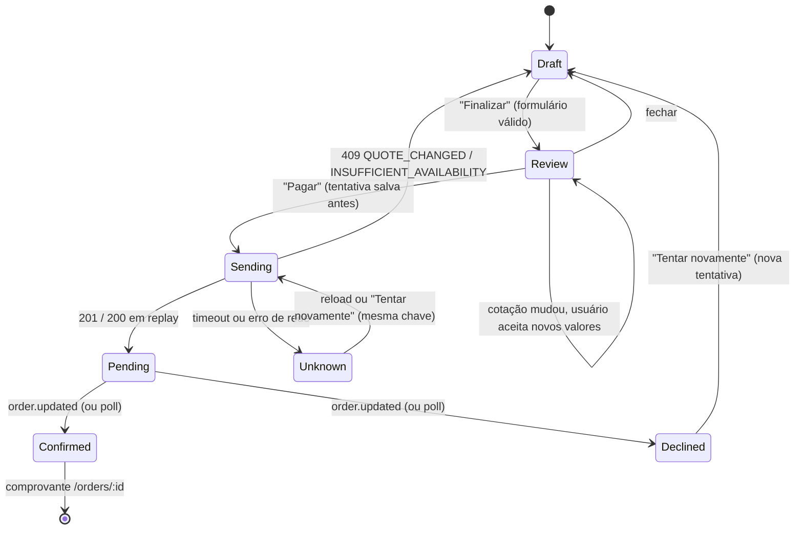

# KURIO — Arquitetura

[English](ARCHITECTURE.md) · **Português (Brasil)**

Como o frontend do marketplace de NFTs é construído e por quê. O enunciado do desafio é o [`OBJETIVES.md`](OBJETIVES.md); como rodar e avaliar o app está no [README](README.pt-BR.md). Toda decisão abaixo foi tomada em uma spec de [`SPECS-NTFS/`](SPECS-NTFS/README.md) (requisitos, design e tarefas por área), que permanece no repositório como registro de design. Os links deste documento apontam para lá, para o raciocínio completo.

O texto da interface é pt-BR, como no Figma; os documentos, o código e os comentários são em inglês. Este arquivo é a tradução para português do [`ARCHITECTURE.md`](ARCHITECTURE.md), que é a versão de referência.

## Sumário

1. [Visão geral](#1-visão-geral)
2. [Layout do código-fonte e limites de importação](#2-layout-do-código-fonte-e-limites-de-importação)
3. [Contratos REST](#3-contratos-rest)
4. [Tempo real](#4-tempo-real)
5. [Sessão](#5-sessão)
6. [Carrinho](#6-carrinho)
7. [Checkout e pedidos](#7-checkout-e-pedidos)
8. [Política de cache, retry e sincronização](#8-política-de-cache-retry-e-sincronização)
9. [Ambiente de mock](#9-ambiente-de-mock)
10. [Estratégia de testes](#10-estratégia-de-testes)
11. [Ajustes de acessibilidade](#11-ajustes-de-acessibilidade)
12. [Notas de desempenho](#12-notas-de-desempenho)
13. [Desvios e decisões](#13-desvios-e-decisões)
14. [Limitações](#14-limitações)

## 1. Visão geral

Uma SPA somente cliente: React 19 e TypeScript, TanStack Router (rotas baseadas em arquivos, com code splitting) e TanStack Query, Axios, Zod 4, Tailwind v4 com shadcn/ui, Playwright e Lighthouse. Não há backend. A API REST e o servidor Socket.IO são **simulados dentro da página**: o MSW intercepta o tráfego de `fetch` e de WebSocket em um Service Worker, e um banco de mock no `localStorage` responde a ele. O código do app não sabe disso: ele fala com `VITE_API_BASE_URL` e `VITE_REALTIME_URL` como falaria com um servidor real, e um build com `VITE_ENABLE_MOCKS=false` não contém nenhum código de mock.

```mermaid
flowchart LR
  UI["Telas e hooks<br/>(features/*, routes/*)"] --> Q["TanStack Query<br/>cache, retry, dedupe"]
  Q --> API["api/* funções de endpoint<br/>(respostas validadas com Zod)"]
  API --> AX["Instância do Axios<br/>lib/http: bearer, 401, erros"]
  AX -- "fetch" --> SW["MSW Service Worker<br/>(no navegador)"]
  SW --> H["mocks/handlers<br/>latência, regras de falha"]
  H --> DB[("Banco de mock<br/>localStorage")]
  DB --> BUS["Barramento de domínio"]
  BUS --> HUB["Hub de tempo real<br/>audiência, log de entrega"]
  HUB -- "frames WebSocket" --> BIND["Binding do Socket.IO<br/>(@mswjs/socket.io-binding)"]
  BIND --> RT["lib/realtime manager<br/>schema, dedupe, guarda de versão"]
  RT -- "patch ou invalidate" --> Q
  RT -- "listeners" --> UI
```



Duas regras moldam todo o resto. Os **contratos** (`src/contracts/`, Zod) são a única descrição do protocolo: o cliente valida toda resposta com eles e os handlers do mock validam toda requisição com eles, então os dois não podem divergir. E o **estado do servidor pertence ao Query**: os componentes nunca guardam uma cópia dos dados da API, as mutations passam pelo Query, e os eventos de tempo real terminam no mesmo cache.

Boot ([spec 13 §5](SPECS-NTFS/13-lighthouse/design.md), [spec 02 §3](SPECS-NTFS/02-contracts-mocks/design.md)): o `main.tsx` renderiza o shell de imediato e inicia o chunk do mock em paralelo. Toda requisição do Axios e a conexão do Socket.IO esperam o `lib/backend-ready.ts` até que se comprove que o worker intercepta, então nada chega à rede por acidente. O `bootApp()` liga a sessão ao cache, ao router e ao socket.

## 2. Layout do código-fonte e limites de importação

```
src/
  app/          bootstrap: router, query client, ponte da sessão, ligação do boot, devtools (só em dev)
  routes/       rotas baseadas em arquivos: guardas, loaders, validação de search, <title> da página; finas
  features/     uma pasta por área, cada uma com api/ (query options, mutations), model/ (lógica pura,
                stores), components/: auth, account, cart, catalog, checkout, explorer, favorites,
                nft-details, orders, receipt; ui-kit e dev-realtime são harnesses de desenvolvimento
  components/   UI compartilhada: ui/ (shadcn reestilizado), form/ (camada de formulário), layout/ (shells), icons/
  api/          funções de endpoint, uma por operação, construídas sobre a instância do Axios
  contracts/    schemas Zod, taxonomia de erros, tabela de operações, envelope de eventos
  lib/          http/ (Axios, erros, interceptors de auth), realtime/, money, env, backend-ready, mock-recovery
  mocks/        handlers do MSW, banco de mock, fixtures, cenários, API de controle, painel, hub de tempo real
  styles/       tokens de tema do Tailwind vindos do Figma
```

Os limites são impostos pelo ESLint (`no-restricted-imports`, [spec 00 §9](SPECS-NTFS/00-foundation/design.md), [spec 02 §12](SPECS-NTFS/02-contracts-mocks/design.md), [spec 03 §7](SPECS-NTFS/03-realtime/design.md)), então quebram o `pnpm lint` em vez de depender de um code review:

| Regra | Por quê |
|---|---|
| `axios` só dentro de `lib/http/`; `fetch` em lugar nenhum de `src/` | Uma única instância carrega a URL base, o timeout, o bearer, o mapeamento de erros e o cancelamento |
| `socket.io-client` só dentro de `lib/realtime/` | Um único manager é dono da conexão, da deduplicação e da reconciliação |
| `@mswjs/socket.io-binding` e tudo sob `mocks/` só a partir de `mocks/` e do import dinâmico do bootstrap (`main.tsx`) | O código de mock precisa poder ser removido de um build |
| `contracts/` importa só `zod` e `lib/money` | Os contratos são compartilhados por código de cliente e de servidor; sem React, sem MSW |
| `mocks/` nunca importa `api/`, `lib/http`, `lib/realtime`, `features/`, `routes/` | Os mocks implementam o servidor; não podem usar o cliente |
| Nenhum pacote de ícones (`lucide-react` bloqueado) | Os ícones vêm das exportações do Figma em `src/assets/` |

As rotas são finas de propósito: um arquivo de rota declara o seu caminho, o `validateSearch` (schemas Zod 4 com `.catch()`/campos opcionais, de modo que uma URL malformada degrada para os padrões em vez de lançar erro), uma guarda (`requireAuth`), um loader que inicia o fetch do Query e o componente de página vindo de `features/`. Não existe um layout `_authenticated`; cada rota privada chama `requireAuth` ([spec 04 §6](SPECS-NTFS/04-auth-session/design.md)).

## 3. Contratos REST

A tabela de operações vive em `src/contracts/operations.ts` e é compartilhada pelo cliente (`api/`) e pelo servidor mock (`mocks/handlers`). A tabela abaixo é gerada a partir dela por `pnpm docs:update` (e verificada pelo `pnpm test`), então não pode divergir; as colunas de requisição, sucesso e erros vêm de um mapa tipado sobre todos os ids de operação, então adicionar uma operação quebra o typecheck até que ela seja descrita. URL base: `VITE_API_BASE_URL` (padrão `/api`).

<!-- generated:operations -->

| Operação | Método e caminho | Autenticação | Requisição | Sucesso | Erros |
|---|---|---|---|---|---|
| `auth.signup` | `POST /auth/signup` | nenhuma | `SignupBody` | 201 `SessionPayload` | 422, 409 `EMAIL_TAKEN` / `USERNAME_TAKEN` |
| `auth.login` | `POST /auth/login` | nenhuma | `LoginBody` | 200 `SessionPayload` | 422, 401 `INVALID_CREDENTIALS` |
| `auth.session` | `GET /auth/session` | bearer | — | 200 `SessionInfo` | 401 |
| `auth.logout` | `POST /auth/logout` | bearer, ignorado se inválido | — | 204 | — |
| `nfts.list` | `GET /nfts` | bearer opcional | `NftListQuery` | 200 `NftListResponse` | 422, 401 (com `favorites`) |
| `nfts.get` | `GET /nfts/:nftId` | nenhuma | — | 200 `NftDetail` | 404 |
| `nfts.related` | `GET /nfts/:nftId/related` | nenhuma | — | 200 `{ items: NftSummary[] }` | 404 |
| `highlights.get` | `GET /highlights` | nenhuma | — | 200 `Highlights` | — |
| `networks.list` | `GET /networks` | nenhuma | — | 200 `{ items: PaymentNetwork[] }` | — |
| `explorer.getTransaction` | `GET /explorer/:network/tx/:txHash` | nenhuma | — | 200 `ExplorerTransaction` | 404 |
| `favorites.list` | `GET /favorites` | bearer | — | 200 `{ nftIds: NftId[] }` | 401 |
| `favorites.add` | `PUT /favorites/:nftId` | bearer | — | 204 | 401, 404 |
| `favorites.remove` | `DELETE /favorites/:nftId` | bearer | — | 204 | 401 |
| `cart.get` | `GET /cart` | bearer ou id do carrinho de visitante | — | 200 `Cart` | 401 |
| `cart.addItem` | `POST /cart/items` | bearer ou id do carrinho de visitante | `AddCartItemBody` | 200 `Cart` | 422, 404, 409 `INSUFFICIENT_AVAILABILITY` / `EDITION_UNAVAILABLE` |
| `cart.updateItem` | `PATCH /cart/items/:itemId` | bearer ou id do carrinho de visitante | `UpdateCartItemBody` | 200 `Cart` | 422, 403, 404, 409 |
| `cart.removeItem` | `DELETE /cart/items/:itemId` | bearer ou id do carrinho de visitante | — | 200 `Cart` | 403, 404 |
| `cart.applyCoupon` | `PUT /cart/coupon` | bearer ou id do carrinho de visitante | `{ code }` | 200 `Cart` | 422 `COUPON_INVALID` / `COUPON_EXPIRED` / `COUPON_NOT_APPLICABLE` |
| `cart.removeCoupon` | `DELETE /cart/coupon` | bearer ou id do carrinho de visitante | — | 200 `Cart` | — |
| `cart.merge` | `POST /cart/merge` | bearer | `{ guestCartId }` | 200 `CartMergeResult` | 401, 422 |
| `quote.get` | `GET /cart/quote` | bearer ou id do carrinho de visitante | query `network` | 200 `Quote` | 422 |
| `orders.create` | `POST /orders` | bearer | `CreateOrderBody` + `Idempotency-Key` | 201 `Order` (200 em replay) | 401, 422, 409 `QUOTE_CHANGED` / `INSUFFICIENT_AVAILABILITY` / `IDEMPOTENCY_CONFLICT` / `ORDER_PENDING` / `WALLET_NOT_CONNECTED` |
| `orders.get` | `GET /orders/:orderId` | bearer | — | 200 `Order` | 401, 403, 404 |
| `orders.list` | `GET /orders` | bearer | query `status` | 200 `{ items: OrderSummary[] }` | 401 |
| `profile.get` | `GET /profile` | bearer | — | 200 `Profile` | 401 |
| `profile.update` | `PUT /profile` | bearer | `UpdateProfileBody` | 200 `Profile` | 401, 422, 409 `USERNAME_TAKEN` / `EMAIL_TAKEN` |
| `profile.uploadAvatar` | `PUT /profile/avatar` | bearer | multipart `file` | 200 `Profile` | 401, 413, 415 |
| `profile.removeAvatar` | `DELETE /profile/avatar` | bearer | — | 200 `Profile` | 401 |
| `profile.changePassword` | `PUT /profile/password` | bearer | `ChangePasswordBody` | 204 | 401, 422 |
| `wallets.list` | `GET /wallets` | bearer | — | 200 `{ items: Wallet[] }` | 401 |
| `wallets.create` | `POST /wallets` | bearer | `CreateWalletBody` | 201 `Wallet` | 401, 422, 409 `WALLET_DUPLICATE` / `WALLET_ROLE_TAKEN` |
| `wallets.update` | `PUT /wallets/:walletId` | bearer | `WalletFields` | 200 `Wallet` | 401, 403, 404, 422, 409 `WALLET_DUPLICATE` |
| `walletConnections.list` | `GET /wallet-connections` | bearer | — | 200 `{ items: WalletConnection[] }` | 401 |
| `walletConnections.connect` | `POST /wallet-connections` | bearer | `{ walletId, provider, network }` | 201 `WalletConnection` | 401, 403, 404, 422, 409 `WALLET_REJECTED` |
| `walletConnections.disconnect` | `DELETE /wallet-connections/:connectionId` | bearer | — | 204 | 401, 403, 404 |

<!-- /generated:operations -->

Headers: `Authorization: Bearer <token>`; `X-Guest-Cart-Id: <id>` (ignorado quando há um bearer válido); `Idempotency-Key: <8–64 chars>` em `orders.create`. Qualquer operação pode responder, adicionalmente, 429, 500 ou 503. Os schemas dos recursos estão em `src/contracts/*.ts`; o resumo está na [spec 02 §4](SPECS-NTFS/02-contracts-mocks/design.md).

**Envelope de erro.** Todo corpo de erro é `{ error: { code, message, fields?, details? } }`. `code` é uma união fechada, `message` é pt-BR e seguro para exibir, `fields` mapeia caminhos de campo com pontos para mensagens (`collector.email`), e `details` tem um formato por código (`QUOTE_CHANGED` carrega a nova cotação, `INSUFFICIENT_AVAILABILITY` as linhas e seus limites, `RATE_LIMITED` um `retryAfterMs`). O cliente transforma uma requisição que falhou em um único `ApiError` com um `kind` (`network`, `timeout`, `http`, `cancelled`, `contract`, `unknown`) e interpreta o envelope; um corpo que não bate com o schema de `details` do seu código vira `UNKNOWN`, então o cliente nunca estreita o tipo sobre um contrato quebrado. `isApiError(e, 'QUOTE_CHANGED')` estreita `e.details`.

<!-- generated:errors -->

| Código | Status | Mensagem padrão (pt-BR) |
|---|---|---|
| `VALIDATION_FAILED` | 422 | Alguns campos precisam de atenção. |
| `COUPON_INVALID` | 422 | Cupom inválido. |
| `COUPON_EXPIRED` | 422 | Este cupom expirou. |
| `COUPON_NOT_APPLICABLE` | 422 | Este cupom não se aplica ao seu carrinho. |
| `UNAUTHENTICATED` | 401 | Entre na sua conta para continuar. |
| `SESSION_EXPIRED` | 401 | Sua sessão expirou. Entre novamente. |
| `INVALID_CREDENTIALS` | 401 | E-mail ou senha incorretos. |
| `FORBIDDEN` | 403 | Você não tem permissão para acessar este recurso. |
| `NOT_FOUND` | 404 | Recurso não encontrado. |
| `INSUFFICIENT_AVAILABILITY` | 409 | A quantidade pedida não está mais disponível. |
| `EDITION_UNAVAILABLE` | 409 | Esta edição está esgotada. |
| `QUOTE_CHANGED` | 409 | Os valores do seu pedido mudaram. Revise e confirme novamente. |
| `IDEMPOTENCY_CONFLICT` | 409 | Esta tentativa já foi usada com outro conteúdo. |
| `ORDER_PENDING` | 409 | Você já tem um pedido aguardando confirmação. |
| `EMAIL_TAKEN` | 409 | Este e-mail já está cadastrado. |
| `USERNAME_TAKEN` | 409 | Este nome de usuário já está em uso. |
| `WALLET_DUPLICATE` | 409 | Este endereço já está em outra carteira sua. |
| `WALLET_ROLE_TAKEN` | 409 | Você já tem uma carteira neste papel. |
| `WALLET_REJECTED` | 409 | A carteira recusou a conexão. |
| `WALLET_NOT_CONNECTED` | 409 | Conecte a carteira para continuar. |
| `PAYLOAD_TOO_LARGE` | 413 | O arquivo é grande demais. |
| `UNSUPPORTED_MEDIA_TYPE` | 415 | Formato de arquivo não suportado. |
| `RATE_LIMITED` | 429 | Muitas tentativas. Aguarde um momento. |
| `INTERNAL` | 500 | Algo deu errado do nosso lado. Tente novamente. |
| `SERVICE_UNAVAILABLE` | 503 | Serviço temporariamente indisponível. |

<!-- /generated:errors -->

**Dinheiro.** Os valores em ETH são strings decimais (`'12.30'`), nunca números JSON, e todo cálculo passa por `lib/money.ts` (big.js): nenhuma aritmética de ponto flutuante toca em um preço. O mock normaliza os preços para strings com escala fixa, então a igualdade de strings nunca decide uma mudança de preço (ele usa `eth.cmp`). Todos os valores estão em ETH, inclusive na Solana: a rede de pagamento muda apenas a taxa e a família da carteira ([spec 02 decisão 3](SPECS-NTFS/02-contracts-mocks/design.md)).

**Idempotência.** `orders.create` exige uma `Idempotency-Key`. O servidor guarda `key → (impressão digital do corpo, pedido)`: a mesma chave com o mesmo corpo devolve o mesmo pedido (200 em vez de 201), a mesma chave com outro corpo é `IDEMPOTENCY_CONFLICT`, e um usuário com um pedido ainda pendente recebe `ORDER_PENDING` com o id dele. O lado do cliente desse contrato está no [§7](#7-checkout-e-pedidos).

**Cotações não têm id armazenado nem expiração.** O id de uma cotação é uma impressão digital do conteúdo (subtotal, linhas, cupom, taxa, disponibilidade), então revalidar é recalcular e comparar: qualquer mudança de preço, estoque, cupom ou taxa de rede muda o id e responde `QUOTE_CHANGED` ([spec 02 §8.3](SPECS-NTFS/02-contracts-mocks/design.md)).

**Propriedade.** O recurso de outro usuário endereçado por id (um pedido, uma carteira, uma linha do carrinho) responde 403, não 404, para que o caso de "permissão insuficiente" do enunciado seja observável.

## 4. Tempo real

Dois eventos, ambos via Socket.IO somente com o transporte WebSocket: `nft.updated` (um preço ou a disponibilidade de uma edição mudou) e `order.updated` (um pedido passou para `confirmed` ou `declined`). O nome do evento é igual a `type` e o payload é o envelope inteiro:

```ts
{ id: 'evt_nft.updated_emerald-ape-042_4',   // evt_<type>_<resourceId>_<version>
  type: 'nft.updated' | 'order.updated',
  resource: { type: 'nft' | 'order', id },
  version: number,                            // a versão do recurso depois da mudança
  occurredAt: IsoDateTime,
  data: NftLive | OrderLive }                 // campos ao vivo, nunca um delta
```

Como `data` traz os **campos ao vivo atuais** do recurso, aplicar apenas o evento mais novo dá o estado correto: uma versão pulada é inofensiva, e uma reentrega tem o mesmo id.

**Pipeline do cliente** (`lib/realtime/manager.ts`, [spec 03 §6](SPECS-NTFS/03-realtime/design.md)). Para cada evento recebido: descarta-o se veio de um socket obsoleto; interpreta-o com o schema (um payload inválido é descartado com um aviso); executa a **guarda**, que o classifica como `duplicate` (id já visto), `stale` (versão não mais nova que a última aplicada para aquele recurso, nem que a dos dados em cache) ou `known` (o cache já tem essa versão, mas entradas mais antigas ainda podem precisar de correção); aplica-o ao cache; chama os listeners. Os appliers padrão fazem patch em `['nfts', …]` e `['orders', 'detail', id]` no próprio lugar com `setQueryData(…, { updatedAt })`, mantendo o `dataUpdatedAt` de cada entrada, de modo que o patch nunca faz um dado obsoleto parecer novo, e nunca revertem nada mais novo. As listas são marcadas como stale sem refetch imediato, então uma lista ordenada por preço não pisca.

**Assinaturas e isolamento de sessão.** O manager só conecta quando foi iniciado **e** a sessão é conhecida, então um usuário logado nunca conecta primeiro como visitante; o socket envia `auth: { token }` (`{}` para um visitante). `nft.updated` vai para todas as conexões, `order.updated` só para as conexões do dono cuja sessão ainda seja válida no momento da entrega. Qualquer mudança de identidade substitui o socket (`off`, `disconnect`, uma nova instância com o novo token) e zera a guarda, e todo handler antes confere que o seu socket ainda é o atual. A checagem de audiência no servidor e a guarda no cliente são duas camadas independentes.

**Reconexão e reconciliação.** O status é `connecting`, `connected`, `reconnecting` ou `disconnected`. Em um `connect` que segue um connect anterior do mesmo socket, o manager invalida todas as queries em cache: as ativas refazem o fetch (preços, estoque, pedidos liquidados enquanto o socket estava fora) e as demais ficam stale no próximo uso. Não há log de eventos perdidos no servidor, então **a reconciliação via REST é o mecanismo de recuperação**; um backend real acrescentaria um cursor de retomada, o que o enunciado não pede. Um pedido pendente também tem um poll REST de 5 s como fallback, que para quando o status é terminal.

**O que escuta além das telas** (`app/boot.ts`): um listener sempre ativo de `nft.updated` (também para eventos `known`) atualiza o carrinho se o carrinho do dono tiver uma linha daquele NFT, onde quer que o usuário esteja; um listener de `order.updated` registra os eventos que chegam antes de o pedido existir em cache (R7), e um status terminal invalida o carrinho e as listas de pedidos e encerra a tentativa de checkout armazenada de um pedido confirmado.

**Transporte usado pelo mock e seus limites** ([spec 03 §3, §12](SPECS-NTFS/03-realtime/design.md)). Sejamos explícitos sobre o que é simulado:

- O "servidor" Socket.IO roda **dentro da interceptação do Service Worker da página**, não em um processo separado: o suporte a WebSocket do MSW mais o `@mswjs/socket.io-binding@0.2.0`. É somente WebSocket, sem fallback de long-polling.
- O binding não tem rooms, namespaces, acknowledgements nem heartbeat, então o hub do mock roteia por conexão por conta própria e dá ping a cada 20 s. Ele esconde o `auth` do CONNECT, então o mock interpreta o frame bruto `40{…}`. O MSW remove o caminho `/socket.io/`. Recusar uma conexão (`offline`, drop com `block`) usa um objeto privado do MSW (`Reflect.get(client, 'socket')`); se o MSW o mudar, a recusa degrada para o timeout de conexão de 10 s.
- Os eventos chegam **apenas à aba que causou a mudança**: o banco de mock vive no `localStorage` e publica as mudanças de domínio na aba que as escreveu; as outras abas se atualizam ao receber o foco (multiaba: a última escrita vence).
- Uma queda de rede real abaixo do WebSocket não pode ser simulada; a desconexão é conduzida pelo controle do mock (`__mock.realtime.drop()`, o cenário `offline`, "Tempo real indisponível" no painel).
- Uma mudança confirmada entre a primeira leitura REST e o handshake do socket não é empurrada. As reconexões reconciliam; a primeira conexão não (o R6 foi tentado duas vezes e removido: custava uma requisição extra em todo carregamento a frio e deixava intermitentes os testes que contam requisições, [spec 03 §14](SPECS-NTFS/03-realtime/design.md)). O poll de 5 s do pedido, o refetch ao focar a janela e a revalidação da cotação no checkout cobrem os dados que importam.
- Com os mocks desligados, `VITE_REALTIME_URL` precisa apontar para um servidor real; o padrão é um host `.example` reservado, para que uma interceptação que falhe nunca consiga alcançar um.

## 5. Sessão

Implementada em `features/auth/model/session.ts` como um controller criado por uma factory (storage, verify e clock injetados), com um singleton em `instance.ts` ([spec 04](SPECS-NTFS/04-auth-session/design.md)).

- **Armazenamento do token.** Token bearer e resumo do usuário no `localStorage` (`kurio.session`). É uma escolha da simulação: em produção o token seria um cookie HttpOnly e SameSite, que uma SPA não consegue ler, então o carrinho e o checkout não precisariam tocar nele. As senhas são hasheadas (PBKDF2, 100 000 iterações, uma configuração da simulação) no banco de mock; as senhas de demonstração em texto puro existem apenas nas fixtures de teste e no README, não no bundle de produção.
- **Expiração.** Um TTL fixo (2 h; `session-short` o reduz a 60 s), sem refresh. A sessão é verificada no boot e no máximo a cada 60 s em navegação protegida. Um 401 *para o token atual* significa expirada; o token que uma requisição falha carregava é lido do erro do Axios, então um 401 causado por um token antigo nunca expira a sessão nova, e 401s concorrentes agem uma única vez.
- **Preservação do redirect.** Uma rota protegida envia o visitante deslogado, ou com sessão expirada, para `/login?redirect=<href atual>` (com `reason=expired` na expiração). Apenas caminhos de mesma origem sobrevivem ao schema de `redirect`, então não há open redirect. Depois do login, o formulário executa as tarefas pós-login (merge do carrinho) e então navega para o destino. Expirações causadas por uma guarda de rota não disparam toast, então há um único aviso, não dois.
- **Isolamento na mudança de identidade.** Toda mudança de identidade (`login`, `signup`, `logout`, `expired`, `other-tab`) cancela as queries em andamento, limpa o cache do Query **inteiro**, substitui o socket e incrementa uma **epoch**; as mutations capturam a epoch e descartam um resultado tardio se ela mudou (favoritos, adicionar ao carrinho, escritas de perfil). As outras abas acompanham pelo evento `storage`. As chaves de query de dados privados também carregam o dono (`['cart', 'user:<id>']`, `['favorites', userId]`, `['account', userId, …]`), então nada pode aparecer para outra identidade nem antes da limpeza.
- **Restauração.** O `bootApp()` inicia a restauração. Uma sessão armazenada atrasa a primeira rota protegida em um round trip de `auth.session` (com retries em 300 ms e depois 900 ms, então uma visita offline espera cerca de 1,2 s no máximo); uma visita sem sessão armazenada não paga nada. Uma expiração encontrada no boot em uma rota pública é silenciosa.
- **O logout é local** mesmo que a chamada à API falhe, e tira o usuário de uma rota protegida para `/`.

## 6. Carrinho

([spec 07](SPECS-NTFS/07-cart/design.md), com o adicionar ao carrinho da spec 06.)

- **Carrinho no servidor.** O carrinho pertence ao servidor: as mutations escrevem o que a API responde (`applyCart` protegido por versão), não palpites otimistas. Uma leitura mais antiga que o carrinho em cache (`version` menor) é descartada, e uma mutation cancela a leitura em andamento antes de escrever. O stepper de quantidade passa por uma fila de último valor, então cliques rápidos enviam o valor final.
- **Carrinho de visitante.** Um visitante também tem carrinho: a primeira adição o cria e a API devolve um id impossível de adivinhar (`g_<32 hex>`), guardado no `localStorage` (`kurio.guestCartId`) e enviado como `X-Guest-Cart-Id`. O id é descartado quando o servidor não o conhece.
- **Merge no login.** Depois de todo login (e em uma restauração quando um merge anterior não conseguiu terminar), `cart.merge` junta o carrinho do visitante ao do usuário: as quantidades se somam, limitadas ao limite da linha; linhas indisponíveis não são adicionadas; o cupom do próprio usuário é mantido (o do visitante só vale se o usuário não tinha nenhum). O resultado lista os ajustes e **um único toast** ("Carrinho ajustado ao entrar") os relata, uma linha por linha ajustada — nunca em silêncio. Um merge que falha mostra um toast de erro com nova tentativa; o id do visitante é mantido.
- **Cotação.** O resumo (subtotal, desconto, taxa de rede, total) vem somente de `quote.get`, com a chave `['cart', owner, 'quote', network, version]`. O carrinho sempre cota a Ethereum ("Taxa estimada"); o checkout pede a cotação da rede escolhida.
- **Mudanças ao vivo.** A `version` do carrinho não se move quando um NFT muda, então `nft.updated` **invalida** a chave do carrinho (e a cotação dele, por prefixo) em vez de fazer patch; o refetch mostra os avisos nas linhas ("preço mudou", "limitado", "indisponível"). Enquanto a nova cotação carrega, os valores anteriores do mesmo dono permanecem, esmaecidos, e o checkout fica desabilitado até ela chegar. Os avisos são anunciados quando o texto deles muda.
- **Cupons.** `KURIO10` (10%), `COLECAO05` (0.05 ETH acima de 0.50 ETH) e `VERAO25` (expirado) nas fixtures; um código inválido ou expirado mantém o que foi digitado e mostra a mensagem da API no campo.

## 7. Checkout e pedidos

([spec 09](SPECS-NTFS/09-checkout-orders/design.md), [spec 10](SPECS-NTFS/10-order-confirmation/design.md).)



- **Formulário e revisão.** O checkout é um formulário (TanStack Form + schema Zod construído a partir do `CollectorDetails` do contrato), seguido de uma etapa de **revisão** (dialog a partir de `lg`, bottom sheet abaixo) que revalida tudo. A revisão guarda um `id` de cotação específico; se a cotação do cache tem outro, a tela mostra as diferenças e o usuário precisa pressionar "Aceitar novos valores". O pagamento também fica desabilitado enquanto a cotação é rebuscada, então um `quoteId` desatualizado nunca pode ser enviado. Faltas de estoque (`INSUFFICIENT_AVAILABILITY`) bloqueiam o pedido e mostram os novos limites.
- **Carteira.** Só carteiras cadastradas pagam. A conexão simulada é casada por carteira + provedor + rede; mudar qualquer um deles mostra "Carteira desconectada". Uma conexão recusada (`wallet-reject`) ou uma queda (`__mock.disconnectWallet()`) é um estado visível e recuperável.
- **Ciclo de vida da chave de idempotência.** Uma chave por **tentativa**. A tentativa é uma pequena máquina de estados no `localStorage` (`phase: 'sent' | 'rejected'` mais um `orderId` opcional), **escrita antes da requisição**. O mesmo corpo canônico reaproveita a chave, um corpo alterado ganha uma nova. Se a resposta se perde (timeout, reload), a tentativa é reenviada uma vez com a mesma chave, e o servidor devolve o pedido que já existe: **um timeout nunca cria um segundo pedido e nunca cobra duas vezes**. Uma tentativa sem resposta é recuperável por 10 minutos (`ATTEMPT_TTL_MS`, R2), então uma tentativa antiga nunca pode pagar sem um clique. Um pedido liquidado encerra a sua tentativa (R3), e entrar como outra pessoa elimina o rascunho e a tentativa do usuário anterior (R8); uma expiração os mantém, para que o mesmo usuário retome.
- **Acompanhamento.** Depois de criado, o pedido fica `pending`. O `order.updated` o liquida; um poll REST de 5 s é o fallback e para em um status terminal. Uma resposta mais antiga que o pedido em cache nunca desfaz `confirmed` nem `declined` (checagem de versão). `confirmed` navega com `replace` para `/orders/$orderId`, então o Voltar nunca retorna a um formulário de um pedido que já foi pago.
- **Recusado** mantém o carrinho intacto e reabre o formulário a partir dos dados do pedido, com uma nova tentativa. **Apenas as linhas compradas** saem do carrinho quando um pedido é liquidado.
- **Comprovante** (`/orders/$orderId`) é construído somente a partir do **snapshot do pedido** (valores imutáveis: uma mudança de preço depois da confirmação, mais um reload, o deixa inalterado), sem leitura do catálogo. O pedido de outro usuário mostra uma tela 403 sem dados; um pedido inexistente mostra not-found; pedidos pendentes e recusados reaproveitam os painéis do checkout, e a confirmação só é exibida para `confirmed` (enunciado §3.3).
- **Explorador de blocos simulado** (emenda da spec 10). "Ver no Etherscan" abre uma página pública interna, `/explorer/$network/tx/$txHash`, apoiada pela operação `explorer.getTransaction`. Ela mostra apenas dados públicos da chain (hash, status, bloco, hora, endereço do pagador, um contrato fictício do marketplace, valor, taxa, itens), nunca o colecionador, o e-mail nem o id do pedido, e diz que é simulada. Abre na mesma aba para que o Voltar retorne ao comprovante, e um hash ou uma rede desconhecidos dão not-found.

## 8. Política de cache, retry e sincronização

**Padrões** (`app/query-client.ts`, [spec 00 §6](SPECS-NTFS/00-foundation/design.md)):

| Opção | Valor | Por quê |
|---|---|---|
| `staleTime` | 30 s | Evita tempestades de refetch na navegação; o tempo real e a invalidação mantêm os dados atualizados. |
| `gcTime` | 5 min (padrão) | |
| `retry` | `failureCount < 2 && isRetryable(error)` | Tenta de novo em rede, timeout, 408, 429 e 5xx; nunca em outros 4xx e nunca em cancelamentos. Os atrasos são o exponencial padrão de 1 s, 2 s. |
| `refetchOnWindowFocus`, `refetchOnReconnect` | `true` | Reconciliação barata de preços e disponibilidade. |
| `retry` das mutations | `0` | Uma escrita nunca é reenviada automaticamente. A recuperação de uma resposta perdida é explícita e idempotente ([§7](#7-checkout-e-pedidos)). |

Toda query function recebe o `signal` do Query e o repassa ao Axios, então uma navegação ou uma busca mais nova cancela a requisição. O tipo de erro padrão é registrado como `ApiError`.

**Sobrescritas por query**

| Query | Sobrescrita | Motivo |
|---|---|---|
| Detalhe do pedido | `staleTime` 30 s; uma resposta mais antiga que o pedido em cache é descartada | Os eventos o mantêm atualizado; um poll não pode desfazer uma liquidação |
| Pedidos pendentes | `staleTime` 5 s | O portão do checkout precisa estar atualizado a cada visita |
| Conexões de carteira | `staleTime` 0 | A conexão pode mudar a qualquer momento |
| Redes, transação do explorador | `staleTime` `Infinity` | Fixture estática; uma transação registrada nunca muda |
| Perfil, carteiras | `staleTime` 60 s | Escritos pelo usuário, lidos com frequência |
| Loader de detalhes | `staleTime: 'static'` no loader da rota; a query tem o seu próprio retry (`retryTransient`) | O loader roda fora dos padrões do client |
| Lista do catálogo | `placeholderData: keepPreviousData`; retry só em transitórios | Os cards antigos ficam (esmaecidos) enquanto uma nova página carrega |
| Replay do acompanhamento do pedido | `retry: false`, `gcTime: 0` | Um replay é explícito |

**Catálogo de chaves de query.** Os prefixos são contratos: os appliers de tempo real dependem de `['nfts', …]` e de `['orders', 'detail', id]`.

| Chave | Guarda | Dono da chave |
|---|---|---|
| `['nfts', 'list', query]` | `NftListResponse` para uma query normalizada | catalog |
| `['nfts', 'detail', id]`, `['nfts', 'related', id]` | `NftDetail`, NFTs relacionados | catalog (compartilhada com details e cart) |
| `['highlights']` | hero da home e banner de destaque | catalog |
| `['favorites', userId]` | `{ nftIds }` | favorites |
| `['cart', owner]`, `['cart', owner, 'quote', network, version]` | `Cart`; `Quote` (filha da entrada do carrinho) | cart |
| `['account', userId, 'profile' / 'wallets']` | `Profile`; carteiras | account |
| `['networks']`, `['wallet-connections', userId]` | taxas e nomes; conexões simuladas | checkout |
| `['orders', 'detail', id]` | `Order` | orders |
| `['orders', 'list', …]` (`{ status }` para o portão de pendentes) | `OrderSummary[]` | orders |
| `['explorer', 'tx', network, hash]` | `ExplorerTransaction` | explorer |
| `['checkout', 'recovery', userId, key]` | um replay de uma tentativa sem resposta | checkout |

`owner` é `user:<id>` ou `guest`. Os pedidos não carregam o usuário na chave: são buscados com o bearer (o de outro usuário dá 403) e o cache inteiro é limpo a cada mudança de identidade.

**Matriz de invalidação** (o que uma mutation ou um evento faz em cada chave):

| Gatilho | Efeito |
|---|---|
| `nft.updated` | **Patch** nas entradas de `['nfts', …]` mais antigas que o evento (preço, `previousPrice`, disponibilidade, edições, versão); marca as listas como stale sem refetch; **invalida** o carrinho do dono (e a cotação) se ele tiver aquele NFT |
| `order.updated` | **Patch** em `['orders', 'detail', id]` se estiver em cache e for mais antigo; invalida as listas de pedidos; um status terminal invalida `['cart']` e as listas de pedidos e limpa a tentativa de um pedido confirmado |
| Reconexão do socket | Invalida **tudo**; as queries ativas refazem o fetch |
| Mutation do carrinho (adicionar, atualizar, remover, cupom, merge) | Cancela a leitura do carrinho, **escreve** a resposta (protegido por versão); a cotação abre uma nova entrada para a nova versão |
| Alternar favorito | Escrita otimista; ao liquidar o último toggle daquele NFT, invalida `['favorites', userId]` e as listas do catálogo só de favoritos |
| Atualização de perfil, avatar | Cancela a leitura, escreve a resposta, faz patch no usuário da sessão (protegido por epoch) |
| Salvar carteira | Insere na lista em cache por papel (principal primeiro) e depois a invalida |
| `orders.create` | Semeia `['orders', 'detail', id]` (mantendo uma versão em cache mais nova), atualiza a lista de pendentes, invalida o carrinho |
| Login, logout, troca de usuário, expiração | Cancela e **limpa o cache inteiro**; novo socket; incremento da epoch |

**Atualizações otimistas com rollback.** Os favoritos são a interação otimista exigida pelo enunciado, feita pelo Query (`onMutate` escreve no cache, `onError` desfaz apenas a sua própria intenção, `onSettled` reconcilia) em vez de `useOptimistic`, porque aqui o Query é dono das mutations e da sincronização do cache. O `scope` da mutation é o NFT, então toggles rápidos chegam ao servidor na ordem dos cliques. Uma intenção ainda pendente sobrevive a uma leitura de lista que chega nesse meio-tempo, e uma falha mostra um toast com nova tentativa. Prova: `e2e/favorites.spec.ts`.

**Respostas obsoletas.** Quatro defesas: o `signal` do Query cancela requisições superadas; as leituras do catálogo e do carrinho comparam versões e mantêm os dados mais novos; as mutations cancelam a leitura com que disputariam; e toda escrita no cache vinda de um evento passa pela guarda. O cenário `out-of-order` do mock (a segunda `nfts.list` responde antes da primeira) prova a primeira: um abort do lado da página nunca chega ao Service Worker, então a prova é que nenhuma lista obsoleta é renderizada, não o log de requisições do mock.

## 9. Ambiente de mock

([spec 02](SPECS-NTFS/02-contracts-mocks/design.md).)

- **Banco.** Um estado em memória semeado, persistido de forma síncrona no `localStorage` (`kurio.mock.db`; configuração em `kurio.mock.config`): 120 NFTs, 3 usuários com senhas hasheadas por PBKDF2, favoritos, carrinhos, cupons, pedidos, carteiras e conexões. `write(fn)` roda em um clone e só o troca se `fn` não lançar erro, então todo handler é atômico: nenhum carrinho ou pedido parcial em um 4xx. Um estado de outro `SCHEMA_VERSION`, ou que falhe na validação de formato (`db/validate.ts`), é descartado e semeado de novo. Por navegador: outro perfil começa da seed.
- **Cenários.** Um cenário é uma seed mais uma configuração (latência, regras de falha, fora de ordem, resultado do pagamento, resultado da carteira, TTL da sessão, gatilho do checkout, disponibilidade do tempo real). Selecionar um recarrega a seed e limpa as sobrescritas, então o mesmo cenário sempre se comporta do mesmo jeito. A tabela é gerada no [README](README.pt-BR.md#cenários-e-reset). O tempo é o relógio do navegador (o Playwright e o Vitest o controlam); a liquidação retoma depois de um reload a partir de timestamps persistidos.
- **Condições de rede.** Latência fixa ou em faixa (um PRNG com seed mantém a sequência repetível), pares fora de ordem, regras de falha (status e código `http`, `network-error`, `timeout` antes ou depois de aplicar a operação) com `times`.
- **API de controle** (`window.__mock`): `useScenario`, `reset`, `configure`, `addRule`, `clearRules`, `expireSessions`, `updateNft` (uma mudança de preço ou de estoque "no servidor"), `settleOrder`, `disconnectWallet`, `realtime.*`, `requests()`, `snapshot()`. O painel (`?mockPanel=1` ou `Alt+Shift+M`) é a mesma API com uma interface.
- **Handlers** compartilham um único pipeline (auth, latência, regras, log de requisições). A validação no lado do servidor usa os schemas dos contratos com mensagens em pt-BR.
- **Recuperação do Service Worker** ([spec 13 §11](SPECS-NTFS/13-lighthouse/design.md)). O Lighthouse e o "limpar dados do site" do DevTools podem deixar um registro que não controla a página ou um banco pela metade. O boot tem um prazo de 15 s para `worker.start()`, comprova a interceptação com `GET /api/__mock/health` e, em caso de falha, desregistra os registros obsoletos e recarrega **uma única vez** por aba a cada 30 s (uma guarda, para que a recuperação nunca entre em loop) antes de mostrar a tela de erro de boot, cujo botão também reinicia o worker. `store.load()` semeia de novo um banco danificado. O worker é sondado de novo no foco e no `controllerchange`; uma aba que o perde recarrega uma vez a cada 10 s **sem** desregistrá-lo, porque a causa habitual é o worker novo de outra aba assumindo o controle dela (o Lighthouse limpa os workers e a própria carga dele registra um novo), e desregistrar quebraria as outras abas por sua vez.
- **Limites.** O MSW precisa de um contexto seguro (HTTPS ou `localhost`). A primeira visita paga o registro do worker; a análise da auditoria o quantifica. Os mocks e o tempo real rodam apenas na aba que escreveu a mudança.

## 10. Estratégia de testes

| Camada | Ferramenta | Cobre |
|---|---|---|
| Unitário | Vitest (node) | Módulos puros: money, env, schemas de search, controller de sessão, guarda e manager de tempo real, helpers de query, modelos de formulário, store de tentativas, revisão de cotação, scripts de docs e de build. Sem ambiente DOM: o comportamento da UI é provado por E2E |
| Contrato | Vitest + `msw/node` contra o cliente Axios **real** (`src/api/*.contract.test.ts`) | Toda operação, código de erro, propriedade, idempotência, regras de resiliência |
| E2E | Playwright, Chromium desktop (1440×900) e mobile (390×844 Pixel 7), contra o `vite preview` de um build de produção, com mocks | Os 12 cenários exigidos abaixo, mais design system, mocks, explorador, recuperação de boot |
| Acessibilidade | `@axe-core/playwright` na mesma execução E2E (`e2e/a11y.spec.ts`, 254 testes nos dois projetos) | Matriz rota × estado, caminhos de teclado, foco, regiões live, zoom e overflow de 320 a 1440; nenhuma regra do axe é desabilitada |
| Visual | Capturas do Playwright, 14 baselines Linux (`pnpm test:visual`) | Home, detalhes, carrinho, checkout e skeletons; relógio congelado, latência zero do mock, nada mascarado; ignorado fora do Linux |
| Desempenho | Lighthouse CI, 3 execuções por página e perfil, medianas (`pnpm lighthouse`) | Home e detalhes, mobile e desktop; relatórios em `lighthouse/reports/` |

Mapa dos cenários do enunciado §9:

| # | Cenário | Arquivo |
|---|---|---|
| 1 | Busca, filtros combinados, ordenação, paginação, restauração do histórico | `e2e/catalog.spec.ts` |
| 2 | Acesso direto aos detalhes, recursos inexistentes | `e2e/nft-details.spec.ts` |
| 3 | Cadastro, login, expiração da sessão, logout, troca de usuário | `e2e/auth.spec.ts` |
| 4 | Favoritos, incluindo falha da mutation e recuperação | `e2e/favorites.spec.ts` |
| 5 | Carrinho, quantidades, remoção, cupons, persistência após refresh e login | `e2e/cart.spec.ts` |
| 6 | Compra completa, do catálogo ao comprovante confirmado | `e2e/purchase.spec.ts` (mais `e2e/receipt.spec.ts`, `e2e/explorer.spec.ts`) |
| 7 | Falha de pagamento, cliques repetidos, recuperação por timeout do mesmo pedido | `e2e/checkout-failures.spec.ts` |
| 8 | Perfil, avatar, senha, carteiras com erros de validação | `e2e/account.spec.ts` |
| 9 | Mudança de preço ou de disponibilidade via Socket.IO durante o checkout | `e2e/realtime-checkout.spec.ts` |
| 10 | Eventos duplicados e antigos, desconexão, retomada de pedido pendente | `e2e/realtime-resilience.spec.ts` |
| 11 | Navegação por teclado, foco em dialog, validação de formulário | `e2e/a11y.spec.ts` |
| 12 | Skeletons em carregamento lento, feedback de falha, recuperação por retry | `e2e/loading-states.spec.ts` |
| VR | Regressão visual | `e2e/visual.spec.ts` |

Também: `e2e/smoke.spec.ts` (todas as rotas, not-found, chunk que falha, segurança do redirect), `e2e/mocks.spec.ts` (cenários, reset, API de controle), `e2e/design-system.spec.ts`, `e2e/boot-recovery.spec.ts`.

Convenções que vale conhecer: um abort do lado da página nunca chega ao Service Worker, então o cancelamento é provado a partir da página; testes que fazem o reset de um cenário com uma sessão semeada chamam `forgetSession` antes; todo teste de tempo real espera o NFT ser renderizado antes de alterá-lo (a race conhecida do [§4](#4-tempo-real)); um `page.route()` do Playwright não enxerga as requisições que passam pelo Service Worker, então os testes usam `page.context().route()`. Os harnesses `/dev/*` usados por alguns arquivos E2E existem apenas no build que o Playwright faz (`VITE_ENABLE_DEV_ROUTES=true`); o deploy responde not-found ali ([§13](#13-desvios-e-decisões), Técnico).

## 11. Ajustes de acessibilidade

([spec 01 §11](SPECS-NTFS/01-design-system/design.md), [spec 11 §9](SPECS-NTFS/11-a11y-responsive/design.md), log da auditoria em [`audit.md`](SPECS-NTFS/11-a11y-responsive/audit.md).) A acessibilidade do Lighthouse é 100 em todas as páginas auditadas.

- Um anel de foco visível (accent, 2 px, offset 2), que não está desenhado no Figma; as cores de `border` nunca carregam estado sozinhas, os estados selecionado e atual acrescentam peso ou preenchimento (uma pista que não depende de cor); chips esgotados riscados e preços anteriores têm alternativa em texto.
- A navegação interna para outro caminho move o foco para o `h1` da página (um hook no shell); o primeiro carregamento não. O dialog de busca devolve o foco ao elemento que o abriu; o menu da conta no header é não modal (um menu Radix modal deixava uma página focável sob `aria-hidden`).
- Regiões live: avisos do carrinho, resultados de cupom, prontidão dos favoritos, mudanças de status do pedido, o relatório do merge, anúncios de rota. O toast do merge dura 12 s (WCAG 2.2.1). Nenhuma regra do axe é desabilitada.
- As barras fixas (sheet de resumo do carrinho, barra de ação do checkout, barra do comprovante, tab bar) publicam a sua altura como `--bottom-bar-inset`; as páginas e o `scroll-padding-bottom` a leem, para que o foco nunca termine sob uma barra. Os toasts ficam **no topo, centralizados** nos celulares pelo mesmo motivo.
- O coração de favoritar é inerte (`aria-disabled`, `aria-busy`) até que a lista de favoritos do usuário seja conhecida; continua focável.
- Formulários: rótulos visualmente ocultos mantêm a aparência só com placeholder do Figma, os erros aparecem após o blur ou um submit e o foco vai para o primeiro campo inválido; um `h1` visível por página e por largura.
- Verificado com zoom de 200 %, 400 %, espaçamento de texto da WCAG 1.4.12 e em 320, 360, 390, 768, 1024, 1440 px. O que um leitor de tela lê é verificado na suíte E2E: o nome acessível de cada parada de foco (`ariaSnapshot`), cada mensagem de região live e quantas vezes ela é escrita, e onde o foco cai depois de cada navegação e de cada overlay.

## 12. Notas de desempenho

Medido no `vite preview` com mocks ligados, o cenário padrão, 3 execuções por página e perfil, medianas por categoria e métrica ([`lighthouse/reports/summary.md`](lighthouse/reports/summary.md), análise em [`analysis.md`](lighthouse/reports/analysis.md)):

| Perfil | Página | Perf | A11y | BP | SEO | LCP | CLS | TBT |
|---|---|---:|---:|---:|---:|---:|---:|---:|
| Mobile | Home | **76** | 100 | 100 | 100 | 4,42 s | 0 | 60 ms |
| Mobile | Detalhes | **76** | 100 | 100 | 100 | 4,38 s | 0 | 52 ms |
| Desktop | Home | 98 | 100 | 100 | 100 | 0,96 s | 0 | 0 ms |
| Desktop | Detalhes | 99 | 100 | 100 | 100 | 0,90 s | 0 | 0 ms |

**A Performance mobile (86 no site publicado, 76 contra o `vite preview` local) está abaixo da meta de 90 do enunciado e é um desvio aceito e documentado.** As causas ([spec 13](SPECS-NTFS/13-lighthouse/design.md), `analysis.md`): o slow 4G simulado do Lighthouse, com CPU 4× mais lenta, dá FCP de 3,7 s e LCP de 4,4 s; a URL da imagem do LCP vem da API, então começa tarde (cerca de 3,4 s de atraso de carregamento, porque a cadeia é HTML → entry → chunk do mock → `worker.start()` → API → imagem); e um build de diagnóstico com os mocks desligados chegou a apenas 79–83, então o próprio bundle do app limita a nota a cerca de 80 nesse perfil, com o MSW acrescentando cerca de 0,7 s ao FCP. Não feito de propósito: pular o worker durante as auditorias, embutir os dados das fixtures no HTML, adiar o chunk do mock para depois da primeira pintura (isso moveria o custo para o LCP), fixar um preload do LCP no código (isso acopla o HTML ao catálogo do mock). Os próximos passos possíveis, com estimativas, estão na análise. Todas as outras metas são atingidas nos dois perfis; o CLS é 0 em todo lugar.

O que o app faz pela velocidade: boot com o shell primeiro (renderiza antes de o worker estar pronto, com as requisições seguradas pelo `backend-ready`), chunks de vendor (`react`, `tanstack`) que permanecem em cache entre releases (entry de 376 kB → cerca de 136 kB), subconjunto Latin da fonte e chunk do mock com preload, `tldts` com alias para `tldts-experimental` (chunk do mock de 511 → 351 kB, sem aviso de tamanho de chunk), `robots.txt`, `llms.txt` e `.well-known/ai-catalog.json` como arquivos reais (o rewrite da SPA os responderia com HTML), os quatro primeiros cards do catálogo no celular carregando de imediato com `fetchpriority="high"` (preenchem a primeira tela e qualquer um pode ser o LCP; localmente um empate, veja abaixo), code splitting por rota, tamanhos intrínsecos de imagem (CLS 0) e variantes `srcset`. A auditoria da URL **publicada** está no README.

No celular o LCP é um dos primeiros cards do catálogo, e o Lighthouse apontava a imagem dele como lazy e sem dica de prioridade. Esses cards (`index < 4`, só abaixo de `md`) agora carregam de imediato com `fetchpriority="high"`; a primeira linha no desktop continua lazy para não competir com o hero. Um `<link rel="preload">` para eles foi construído, medido e não mantido: a página é limitada pela cadeia de JavaScript e API do mock, não pela requisição da imagem, então o preload só colocou bytes na frente dessa cadeia (Performance mobile local 70-74 com ele, 73 sem, 76 antes; com a limitação aplicada do Chrome, LCP de 5,69 s antes e 5,58 s depois, então a mudança fica neutra a levemente positiva ali). O LCP simulado do Lighthouse tira imagens lazy de baixa prioridade do grafo, então pedi-las cedo, como deve ser, aparece como cerca de +0,14 s nele. Números e raciocínio: [design da spec 13 §12](SPECS-NTFS/13-lighthouse/design.md).

## 13. Desvios e decisões

Tudo o que as specs registraram, agrupado. Cada linha nomeia a sua spec para o motivo. A fidelidade tela a tela em relação aos frames do Figma (as diferenças medidas, lado a lado) é acompanhada em [`SPECS-NTFS/12-visual-regression/fidelity.md`](SPECS-NTFS/12-visual-regression/fidelity.md); esta seção lista os desvios deliberados e as telas que o Figma não desenha.

**Telas sem frame no Figma:** perfil mobile, carteiras mobile e confirmação mobile (compostos pela [spec 08 §8](SPECS-NTFS/08-profile-wallets/design.md) e pela [spec 10 §6](SPECS-NTFS/10-order-confirmation/design.md)), tablet de 768 px (composição mobile centralizada em 600 px com grid de 3 colunas, [spec 11](SPECS-NTFS/11-a11y-responsive/design.md)), o sheet de filtros mobile ([spec 05](SPECS-NTFS/05-catalog/design.md)), a etapa de revisão do checkout, o explorador simulado e os estados vazio, de erro e de carregamento.

### Figma

| Desvio | Motivo | Spec |
|---|---|---|
| Login e cadastro no desktop são **páginas** que renderizam o painel do Figma, não um modal sobre a home; o comprovante é uma **página roteada** (card centralizado no desktop), não um modal | Acesso direto, refresh e recuperação são exigidos para todas as telas (enunciado §3.3, §4) | [04 §13](SPECS-NTFS/04-auth-session/design.md), [10 §2](SPECS-NTFS/10-order-confirmation/design.md) |
| Cores semânticas derivadas (erro, sucesso, aviso, foco, desabilitado, scrim, skeleton) | Não estão no Figma | [01 §11](SPECS-NTFS/01-design-system/design.md) |
| Escala tipográfica reduzida (17 → 18, 9 → 10); altura de linha do título do hero mobile 29 → 28 | Nenhum degrau da escala corresponde | [01 §11](SPECS-NTFS/01-design-system/design.md) |
| O Chrome renderiza o texto do Figma cerca de 4 % mais largo; o texto dos recursos do rodapé tem 214 px de largura (Figma 204) e a faixa de recursos tem 274 px de altura (Figma 250) | Manter as quebras de linha do Figma | [01 §11](SPECS-NTFS/01-design-system/design.md) |
| Tab bar: o botão central abre a busca, a aba de favoritos vai para `/?favorites=1`; raio superior de 32 px; slots de ícone simétricos (no Figma, levemente assimétricos). A página atual é a cor accent mais `aria-current` (sem ponto, como no Figma), e o notch é um recorte real (furo de 47 px, orelhas de 30 px) | Funções não definidas no Figma; sem token | [01 §11](SPECS-NTFS/01-design-system/design.md), [`fidelity.md`](SPECS-NTFS/12-visual-regression/fidelity.md) |
| Top bar mobile nas telas internas, título de 18 px centralizado | Sem frame; os cerca de 20 px do Figma não são um degrau da escala | [01 §11](SPECS-NTFS/01-design-system/design.md) |
| `aria-current` segue a localização real, enquanto o Figma mantém "Active = Home" nas telas de conta e de autenticação | Semântica correta | [01 §11](SPECS-NTFS/01-design-system/design.md) |
| Header logado: avatar, nome e menu (o Figma desenha apenas "Entrar" nas telas privadas) | Um estado logado precisa existir | [04 §13](SPECS-NTFS/04-auth-session/design.md), [08 §13](SPECS-NTFS/08-profile-wallets/design.md) |
| O cadastro acrescenta uma dica da política de senha; o placeholder "Nome de usuário" no mobile é alinhado à esquerda; os campos usam o preenchimento `ink` com uma borda dentro do card | A política é imposta pela API; consistência | [04 §13–14](SPECS-NTFS/04-auth-session/design.md) |
| As linhas de filtro são checkboxes em negrito e com um ícone de check quando selecionadas; o rótulo de preço usa ponto (`0.02 - 12.30 ETH`); as contagens vêm das fixtures | Pista que não depende de cor; separador decimal em ponto em todo lugar | [05 §15](SPECS-NTFS/05-catalog/design.md) |
| Mídia dos cards normalizada para uma arte centralizada; o card Golden Frequency tem nome e preço; a paginação acrescenta "Anterior" | O Figma os omite | [05 §15](SPECS-NTFS/05-catalog/design.md) |
| O hero não avança sozinho; o texto da promo 2 foi completado; a busca no desktop é um dialog; os links do blog estão indisponíveis; o mobile esconde promos e blog; a paginação fica abaixo do grid, a ordenação dentro do sheet de filtros | Não desenhado ou truncado | [05 §15](SPECS-NTFS/05-catalog/design.md) |
| Detalhes: "Contrato" mostra o endereço e "Direitos autorais" a royalty (o Figma os troca); o breadcrumb inclui o item atual; edições reais nos chips mobile (o Figma repete "1/10"); chips selecionados com contorno; avaliações listadas (≤ 3) com "Mostrando k de n"; sem pontos de paginação no carrossel de relacionados; linha de compartilhar só no desktop; o dialog de zoom é uma galeria (swipe, setas, teclas, pontos) sobre todas as imagens | Inconsistências do Figma; fidelidade dos dados; o Figma desenha uma única imagem ampliada, e "1 de 4" sem caminho para as outras parecia um bug | [06 §13, §17](SPECS-NTFS/06-nft-details/design.md) |
| As linhas do carrinho no desktop mostram a edição; a lixeira mobile foi movida para o canto superior direito do card; linhas de aviso sob as linhas; o rótulo "Código promocional" fica oculto visualmente no mobile; os ids de token por linha do Figma e o subtotal mobile (8.92 contra linhas de 8.14) são ignorados; "(-) 0.00 ETH" no desconto | Distinguir as edições; sobreposição no Figma; texto do design contra dados | [07 §12](SPECS-NTFS/07-cart/design.md) |
| Perfil: `.eth` é um sufixo fixo, não um select de uma opção; "Igual à carteira principal" é um checkbox que não copia o endereço; o campo da carteira alternativa tem um rótulo visível; "Adicionar" fica oculto enquanto um formulário está aberto; texto de dica sob usuário e senha; o avatar é enviado na hora, sem interface de recorte | Opção única; semântica mais clara | [08 §13](SPECS-NTFS/08-profile-wallets/design.md) |
| Checkout: a revisão é um dialog (sheet abaixo de `lg`); título mobile "Carteira", não "Carteira conectada"; "Dados do colecionador" recolhido no mobile; linha 3 da carteira "Rede <name>"; um único valor de provedor com dois controles no desktop; endereço da carteira somente leitura | A conexão acontece na revisão; os pagamentos usam apenas carteiras cadastradas (enunciado §3.3) | [09 §13–14](SPECS-NTFS/09-checkout-orders/design.md) |
| Comprovante: header do shell acima do card, linhas "Subtotal" e "Desconto", uma linha "Edição:", formato de data pt-BR, hash da transação encurtado, texto da faixa em 12 px | Os totais precisam fechar; localidade; a data em pt-BR é mais longa | [10 §10–11](SPECS-NTFS/10-order-confirmation/design.md) |
| Diferenças visíveis deixadas como estão: sem badge do carrinho para visitante (Figma "6"); quatro miniaturas de fixture; linha de relacionados sem pontos de paginação (no máximo 5 itens relacionados, todos visíveis: pontos seriam um controle inerte) e cards com caixa; os pontos de paginação do hero são uma pílula para o slide atual com alvos de 24 px (Figma: três pontos iguais de 8 px) | Comportamento correto; pista que não depende de cor (WCAG 1.4.1) e tamanho do alvo (2.5.8) | [12](SPECS-NTFS/12-visual-regression/design.md), [`fidelity.md`](SPECS-NTFS/12-visual-regression/fidelity.md) |
| O card do hero mobile é mais escuro que o do Figma: gradiente de `primary` a 30 % (Figma cerca de 42 %), círculos a 5 %, e sem a lente mais clara do Figma sob o texto | O texto sobre o card do Figma mede 2,8:1; o nosso mantém 4,5:1 (o teste `contrast over artwork`) | [`fidelity.md`](SPECS-NTFS/12-visual-regression/fidelity.md) item 3b |
| Toasts no topo, centralizados, nos celulares (altera a posição inferior anterior); altura mínima do card do hero mobile 190; a arte do hero no desktop encolhe entre 1024 e 1279 px | Um toast acima da tab bar cobria a última ação; o Figma é desenhado em 414 px | [11 §9](SPECS-NTFS/11-a11y-responsive/design.md) |

### Acessibilidade

| Decisão | Spec |
|---|---|
| Anel de foco, pistas de estado que não dependem de cor, rótulos ocultos, um `h1` por página, foco da rota no `h1`, menu da conta não modal, devolução do foco no dialog de busca | [01 §11](SPECS-NTFS/01-design-system/design.md), [11 §9](SPECS-NTFS/11-a11y-responsive/design.md) |
| Coração interativo inerte até que os favoritos sejam conhecidos; as barras fixas publicam `--bottom-bar-inset`; toast do merge de 12 s; nenhuma regra do axe desabilitada | [11 §9–10](SPECS-NTFS/11-a11y-responsive/design.md) |
| A trilha do carrossel é um `div` (axe `list`); a galeria mobile é uma única região de scroll focável e rotulada; as imagens de promo e de blog são decorativas (`alt=""`); o foco após a paginação só se move em um clique | [05 §15](SPECS-NTFS/05-catalog/design.md), [06 §13](SPECS-NTFS/06-nft-details/design.md) |
| Ações indisponíveis são visíveis e `aria-disabled` ("Disponível em breve"): login social, "Esqueceu a senha?", newsletter, links do blog | [01 §11](SPECS-NTFS/01-design-system/design.md), [04 §13](SPECS-NTFS/04-auth-session/design.md) |

### Assets

| Decisão | Spec |
|---|---|
| Nenhum pacote de ícones (`lucide-react` bloqueado pelo lint); os ícones são SVGs do Figma; ícones desenhados onde o Figma não tem: fechar, check, alert-circle, check-circle, spinner, `eye` (a partir de `eye-off`), `ChevronRight/Down/Up` girados e `MoreHorizontal` a partir das setas e do menu exportados | [00 §14](SPECS-NTFS/00-foundation/design.md), [01 §11](SPECS-NTFS/01-design-system/design.md) |
| Roboto Mono auto-hospedada (variável, subconjunto Latin com preload), sem CDN de fontes | [01 §4](SPECS-NTFS/01-design-system/design.md) |
| Arquivos de arte dos NFTs renomeados para slugs; as imagens têm tamanhos intrínsecos e variantes `srcset`; favicon em `public/` | [02 §16](SPECS-NTFS/02-contracts-mocks/design.md), [10](SPECS-NTFS/10-order-confirmation/design.md) |
| O e-mail `contato@kurio.example` substitui o domínio placeholder do Figma; hosts `.example` em todo lugar, para que nada chegue a um endereço ou servidor reais | [01 §11](SPECS-NTFS/01-design-system/design.md), [03 §13](SPECS-NTFS/03-realtime/design.md) |
| O explorador é uma página interna estilizada com os tokens da KURIO: nenhum logo, cor ou layout de um serviço real é imitado e a página diz que é simulada | [10 §12](SPECS-NTFS/10-order-confirmation/design.md) |

### Interpretação do enunciado

| Decisão | Spec |
|---|---|
| Login social e "Esqueceu a senha?" estão fora do escopo: mostram "Disponível em breve" | [04 §13](SPECS-NTFS/04-auth-session/design.md) |
| "COMPRAR" adiciona ao carrinho e o abre; o botão de carrinho no mobile adiciona e permanece; adicionar ao carrinho é single-flight | [06 §13–14](SPECS-NTFS/06-nft-details/design.md) |
| Favoritar como visitante redireciona para o login e volta; a aba de favoritos no mobile é o catálogo filtrado por favoritos (`/?favorites=1`, exige autenticação) | [05 §15](SPECS-NTFS/05-catalog/design.md), [06](SPECS-NTFS/06-nft-details/design.md) |
| O carrinho sempre cota a Ethereum ("Taxa estimada"); a taxa final depende da rede escolhida no checkout; todos os valores estão em ETH em todas as redes | [07 §12](SPECS-NTFS/07-cart/design.md), [02 §14](SPECS-NTFS/02-contracts-mocks/design.md) |
| Os ajustes do merge do carrinho de visitante são relatados, nunca em silêncio; um merge que falha é visível e pode ser tentado de novo | [07 §12–14](SPECS-NTFS/07-cart/design.md) |
| O recurso privado de outro usuário responde 403 (não 404) para que a "permissão insuficiente" seja observável | [02 §14](SPECS-NTFS/02-contracts-mocks/design.md) |
| As cotações são impressões digitais do conteúdo, sem expiração; o usuário aceita os novos valores explicitamente | [02 §14](SPECS-NTFS/02-contracts-mocks/design.md), [09 §14](SPECS-NTFS/09-checkout-orders/design.md) |
| Política de sessão: TTL fixo, sem refresh; logout local mesmo que a API falhe; a mudança de identidade limpa o cache inteiro e o socket | [04 §13](SPECS-NTFS/04-auth-session/design.md) |
| Um único "Salvar" executa a atualização do perfil e depois a troca de senha e relata cada resultado; o avatar é enviado por conta própria | [08 §13](SPECS-NTFS/08-profile-wallets/design.md) |
| As opções de rede e de tipo da carteira vêm de enums, não de `networks.list`, para que uma requisição de taxa que falha não possa bloquear o formulário | [08 §14](SPECS-NTFS/08-profile-wallets/design.md) |
| O acompanhamento de pendentes usa eventos mais um poll de 5 s; rascunho do checkout no `sessionStorage` e tentativa no `localStorage`, ambos por usuário, limpos no logout (apenas dados fictícios) | [09 §13](SPECS-NTFS/09-checkout-orders/design.md) |
| Comprovante só para pedidos `confirmed`, a partir do snapshot imutável; o explorador é interno e só pode mostrar "Confirmada" | [10 §10–12](SPECS-NTFS/10-order-confirmation/design.md) |
| O mock simula o **servidor** (carrinhos, cotações, pedidos, reservas de disponibilidade); o cliente nunca inventa dados | [02](SPECS-NTFS/02-contracts-mocks/design.md) |

### Técnico

| Decisão | Spec |
|---|---|
| TypeScript fixado em 6.0.x e ESLint em 9.x por compatibilidade de plugins; MSW fixado em 2.x pela faixa de peer do binding | [00 §14](SPECS-NTFS/00-foundation/design.md), [02 §14](SPECS-NTFS/02-contracts-mocks/design.md) |
| O shadcn foi inicializado com `radix-vega` (o `new-york` não é mais oferecido) e todo componente foi reestilizado com os tokens; o `cn` de `clsx` + `tailwind-merge` foi estendido para as escalas customizadas; `react-refresh/only-export-components` desligado em `routes/` | [00 §14](SPECS-NTFS/00-foundation/design.md), [01 §11](SPECS-NTFS/01-design-system/design.md) |
| Caminhos desconhecidos retornam a SPA com **HTTP 200** e o router renderiza not-found (uma limitação de uma SPA na Vercel); um chunk lazy que falha recarrega a página uma vez antes da tela de erro | [00 §14](SPECS-NTFS/00-foundation/design.md) |
| O Axios usa o adaptador fetch para que os timeouts sigam relógios falsos; o Axios limpa o `Content-Type` para `FormData` | [02 §14, §16](SPECS-NTFS/02-contracts-mocks/design.md) |
| ETH como strings decimais com big.js; separador decimal em ponto em todo lugar; preços normalizados para uma escala fixa | [02 §5, §14](SPECS-NTFS/02-contracts-mocks/design.md) |
| PBKDF2 com 100 000 iterações (uma configuração da simulação); senhas de demonstração fora do bundle de produção (G4) | [02 §14, §17](SPECS-NTFS/02-contracts-mocks/design.md) |
| O tempo do mock é o relógio do navegador; multiaba é última escrita vence e os eventos só são publicados na aba que escreve; o Service Worker precisa de um contexto seguro | [02 §14](SPECS-NTFS/02-contracts-mocks/design.md), [03 §12](SPECS-NTFS/03-realtime/design.md) |
| Socket.IO sobre o binding do MSW: somente WebSocket, sem heartbeat, rooms nem acks (o mock dá ping a cada 20 s), `auth` do CONNECT interpretado a partir do frame bruto, recusa por objeto privado; a variável da URL de tempo real é `VITE_REALTIME_URL` | [03 §3, §12–13](SPECS-NTFS/03-realtime/design.md) |
| Tempo real: um evento por versão final; resultados da guarda `duplicate`, `stale`, `known`; os appliers mantêm o `dataUpdatedAt`; a reconexão invalida tudo; a primeira conexão não (R6 removido) | [03 §12–14](SPECS-NTFS/03-realtime/design.md) |
| A restauração da sessão começa no `bootApp()`; boot com o shell primeiro, com requisições seguradas pelo `backend-ready` (altera a spec 02 §3 e a spec 04); guarda de epoch para resultados tardios de mutations | [04 §14](SPECS-NTFS/04-auth-session/design.md), [13 §5](SPECS-NTFS/13-lighthouse/design.md) |
| O serializador de search do router escreve strings simples (listas separadas por vírgula) para que URLs compartilhadas continuem legíveis; parâmetros inválidos são descartados antes da API; o router mescla os parâmetros brutos sob os validados, então as chaves descartadas continuam presentes como `undefined` | [05 §15](SPECS-NTFS/05-catalog/design.md) |
| Os loaders usam `queryClient.query()` (o `prefetchQuery` e o `ensureQueryData`, que ele substitui, estão deprecados); NOT_FOUND vira `notFound()`; `RouteFavorite` lê os dados do loader | [05 §15](SPECS-NTFS/05-catalog/design.md), [06 §14](SPECS-NTFS/06-nft-details/design.md) |
| TanStack Form com uma camada de formulário compartilhada; validação dinâmica (blur e depois change após o submit); `submitForm` contorna um comportamento da biblioteca com erros de blur obsoletos; erros do servidor em `errorMap.onServer` | [04 §14](SPECS-NTFS/04-auth-session/design.md) |
| Só uma composição é montada (`useMediaQuery`), então ids, controles e a imagem do LCP existem uma única vez | [06 §14](SPECS-NTFS/06-nft-details/design.md), [07 §13](SPECS-NTFS/07-cart/design.md) |
| Carrinho: a versão não muda com o NFT, então os eventos invalidam; fila de quantidade; escritas protegidas por versão; dono em toda chave | [07 §13](SPECS-NTFS/07-cart/design.md) |
| Máquina de estados da tentativa do checkout escrita antes da requisição; TTL de 10 min; replay uma vez; limpeza na mudança de identidade | [09 §14–15](SPECS-NTFS/09-checkout-orders/design.md) |
| O Vitest roda em `node` (sem DOM): o comportamento dos componentes é provado por E2E e por testes unitários de módulos puros | [09 §14](SPECS-NTFS/09-checkout-orders/design.md), [10 §11](SPECS-NTFS/10-order-confirmation/design.md) |
| As baselines visuais são só para Linux (com tag de plataforma); os testes `@visual` são ignorados nos demais; capturas mobile reduzidas para pixels CSS | [12 §8–9](SPECS-NTFS/12-visual-regression/design.md) |
| Lighthouse: `pnpm lighthouse` sai com 0 em uma meta perdida (`--strict` falha); `robots.txt`; alias `tldts-experimental`; relatórios commitados em `lighthouse/reports/` (não em `docs/lighthouse/`) | [13 §3, §9](SPECS-NTFS/13-lighthouse/design.md) |
| Recuperação de boot do Service Worker com uma guarda de recarga uma vez a cada 30 s, sonda de saúde e validação do formato do banco | [13 §11](SPECS-NTFS/13-lighthouse/design.md) |
| **As rotas de harness `/dev/*` não vão no deploy.** O UI kit e a página de tempo real são construídos apenas com `VITE_ENABLE_DEV_ROUTES=true` (sempre no servidor de desenvolvimento, definido pelo servidor web do Playwright, desligado em um `pnpm build` comum e no build da Vercel); caso contrário um plugin de build as troca por um stub de not-found, então o código delas nunca chega a `dist/` | [14 §9](SPECS-NTFS/14-docs-delivery/design.md) |
| `<meta name="kurio-build">` carrega o commit a partir do qual o bundle foi construído (o commit da Vercel, senão o `HEAD` local, senão `dev`) | [14 §4](SPECS-NTFS/14-docs-delivery/design.md) |

## 14. Limitações

- **Tudo é simulado.** Sem backend, carteira, chain ou explorador reais; os valores são fictícios; o banco de mock é por navegador, e um banco persistido de um schema mais antigo é semeado de novo (o usuário entra de novo uma vez).
- **O tempo real** é uma simulação de página única: os eventos chegam só à aba que escreve, uma queda de rede abaixo do WebSocket não pode ser simulada, a primeira conexão não reconcilia e não há cursor de retomada ([§4](#4-tempo-real)). A reconexão e o poll do pedido cobrem os casos visíveis.
- **Sessão** com o token no `localStorage` (um design de produção usaria um cookie HttpOnly); sem refresh token.
- **A Performance mobile do Lighthouse é 86 publicada, 76 local (meta 90)**; veja o [§12](#12-notas-de-desempenho). A auditoria mede o app com os mocks ligados.
- **As baselines visuais são só para Linux.** O `pnpm test:e2e` ignora o `@visual` em outros sistemas e informa isso; regenere com `pnpm test:visual:update`.
- **URLs desconhecidas respondem HTTP 200** com a tela de not-found (SPA na Vercel); o `robots.txt`, o `llms.txt` e o `.well-known/ai-catalog.json` são arquivos reais por esse motivo.
- **O paralelismo padrão do Playwright** pode sobrecarregar uma máquina pequena; rode com `--workers=3` (veja o README).
- **Limites conhecidos dos testes:** um 422 do servidor com `fields` não pode ser disparado pela UI com o mock (testado por unidade); uma flake rara foi vista no teste de "três cliques rápidos" dos favoritos (`e2e/favorites.spec.ts`, 1 em 240 execuções, sem causa raiz); o fallback do poll de 5 s é provado apenas em E2E.
- **Fora do escopo por decisão:** login social, recuperação de senha, escrita de avaliações, páginas do blog, newsletter (mostram "Disponível em breve").
